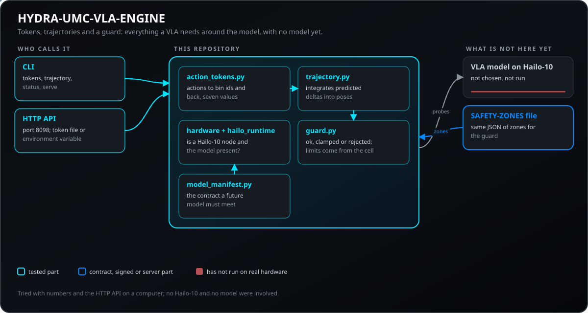
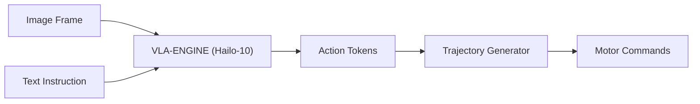
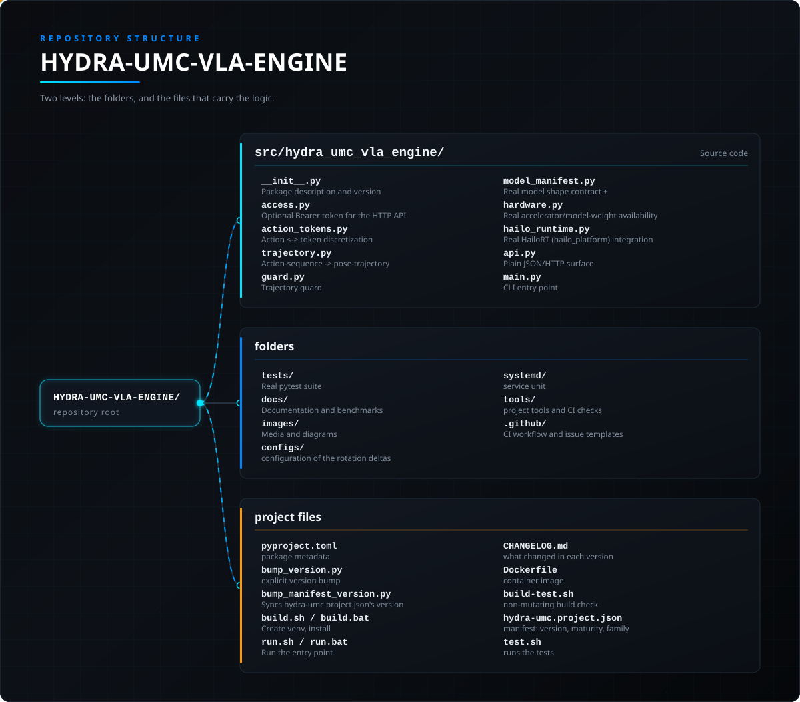

<!-- =============================================================================
HYDRA-UMC-VLA-ENGINE - Vision-language-action engine contracts
Copyright (C) JuanenRac (Electro Hobby 3D) <electrohobby3d@gmail.com>
GPL-3.0-or-later - see LICENSE
============================================================================= -->

<p align="center">
  
</p>

# 🤖 HYDRA-UMC-VLA-ENGINE

<p align="center">🇺🇸 <b>English</b> | <a href="README_spa.md">🇪🇸 Español</a> | <a href="README_fra.md">🇫🇷 Français</a> | <a href="README_ita.md">🇮🇹 Italiano</a> | <a href="README_deu.md">🇩🇪 Deutsch</a> | <a href="README_zho.md">🇨🇳 简体中文</a> | <a href="README_jpn.md">🇯🇵 日本語</a> | <a href="README_por.md">🇵🇹 Português</a></p>

### 🤖 Multimodal Vision-Language-Action Framework for Robotics

<p align="center">
  
  
  
  
  
  
</p>

---

> **Safety and security status:** this ecosystem is not a certified safety system. There is no hardware E-STOP path, no firmware-enforced limits or interlocks and no verified motion command yet; firmware images are checked with CRC-32 and an Ed25519 signature, and a release build refuses the published development keys (the tool heads and expansion boards behind the relay still run URTC bootloaders, which take a shared-key HMAC-SHA256 instead of a signature); TLS and mutual TLS are optional and off by default; no custom board has been populated or tested yet. Read the [security baseline](https://github.com/JuanenRac/HYDRA-UMC-DOCS/blob/main/docs/SECURITY_BASELINE.md) and the [threat model](https://github.com/JuanenRac/HYDRA-UMC-DOCS/blob/main/docs/THREAT_MODEL.md) before relying on any statement here for the safety of a person.

---

## 📋 At a glance

| | |
|---|---|
| Version | `0.1.8` |
| Maturity | Functional |
| Tests | 150 (`python -m pytest -q tests`) |
| Stack | Python / Vision-Language-Action model |
| Target | The Raspberry Pi CM5 of a HYDRA-UMC cell |
| On real hardware | Not yet: no run on real hardware is recorded for this version |

**Jump to:** [Overview](#-overview) · [Architecture](#-architecture) · [Security & Safety](#-security--safety) · [Quick start](#-quick-start) · [Testing](#-testing) · [Repository Structure](#-repository-structure) · [Related Projects](#-related-projects)

## 🚦 Project status

Each line is one part of this repository and the light says how far it is today. It is written from what the repository can show (tests, builds, runs), not from what is planned.

🟢 Done and verified · 🟡 Works, with known limits · 🟠 Partly done or not verified yet · 🔴 Not done or not working

| Area | State | What it means here |
|---|---|---|
| Software | 🟡 | Works for its main purpose; the honesty check above lists what is still missing |
| Tests | 🟢 | 150 automated tests, run on every change |
| Real hardware | 🔴 | Not yet: no run on real hardware is recorded for this version |
| Documentation | 🟢 | README in eight languages, checked against the manifest on every change |

## 🎯 Overview

**HYDRA-UMC-VLA-ENGINE** is meant to be the multimodal bridge that translates visual context and natural language into direct robotic actions. It is intended to run quantized versions of state-of-the-art VLA models (like OpenVLA or specialized RT-2 variants) locally on the Hailo-10 NPU (planned: no model is chosen and no Hailo-10 inference exists yet).

The goal is to let the robot understand commands such as "pick the blue component and place it on the red tray" by analyzing the camera feed and generating the corresponding kinematic sequence. Today the engine codes and decodes action tokens and integrates trajectories within fixed bounds; it does not understand language or images.

### Key Features:
* 🔑 **Optional Bearer token:** on loopback the API needs no token; away from loopback it refuses to start without one (`--token-file` or `HYDRA_UMC_VLA_ENGINE_TOKEN`). With a token set, every request must send `Authorization: Bearer <token>` (constant-time comparison); only `GET /health`, the health path of the manifest, stays open. *(implemented)*
* ✅ **Real v0 - action tokens & trajectory:** `action_tokens.py` implements the OpenVLA/RT-2-style 256-bin discretization scheme (continuous action <-> discrete token, per the 7-DOF pose-delta + gripper action space), and `trajectory.py` integrates a decoded action sequence into an absolute pose trajectory. Exposed via `tokens encode`/`tokens decode`/`trajectory integrate` below - no VLA model or Hailo-10 NPU needed to run or test it.
* 🧯 **A non-number never becomes a movement:** `encode_action` rejects NaN and infinity (clamping a NaN picked the upper bound, so a model that produced NaN was encoded as the maximum movement on every axis), a `vocab_size` outside 2-65536 is refused, and the HTTP API rejects the JSON literals `NaN`/`Infinity` and the strings `"nan"`/`"inf"` with `400`. *(implemented)*
* 📜 **Model manifest + output validation:** A real, versioned contract (`model_manifest.py`) any future model integration must satisfy - matching action/vocab shape and a known Hailo chip family - plus shape/confidence validation for a model's raw inference output. *(implemented)*
* 🚧 **Trajectory guard:** `guard.py` checks a trajectory against the limits of the cell before anyone is asked to approve it: a work volume, the longest step (metres and radians), how much a step may differ from the one before, the range of the gripper, and the zones of HYDRA-UMC-SAFETY-ZONES in their own JSON (a move that enters or crosses a `danger` zone rejects the trajectory, a step inside a `warning` zone is held to a fraction). The outcome is `ok`, `clamped` (a step was cut back and the rest re-integrated from the cut) or `rejected` (no poses are offered, `422`). `serve --guard-file FILE` (or `HYDRA_UMC_VLA_GUARD_FILE`) turns it on for `POST /trajectory/integrate`, `--require-guard` offers nothing without it, and `trajectory integrate --guard-file` does the same on the command line. A proposal never authorizes anything. *(tested with synthetic trajectories; no model and no machine involved)*
* 🔌 **HailoRT integration boundary, prepared ahead of the module:** `hailo_runtime.py` is written against the real, confirmed `hailo_platform` API (`VDevice`, `HEF`, `ConfigureParams`, `InputVStreamParams`/`OutputVStreamParams`) - lazily imported so this repo installs/tests cleanly with no `hailort` package or Hailo-10 module present, and `hailo_output_to_tokens()` (the piece that maps a real inference result onto this engine's own token contract) is fully unit-tested today. *(implemented, integration boundary only - see below)*
* 🩺 **Honest `status` subcommand:** Reports real accelerator/model-weight availability - `no_accelerator`, `no_model_weights`, or `hardware_ready_no_inference` - never a fake "ready" state. *(implemented)*
* 🌉 **Semantic Control (planned):** Direct mapping from pixels and text to joint positions or tool commands. *(needs a real VLA model - future work.)*
* ⚡ **Real-Time Reasoning (planned):** Hailo-10 accelerated inference for low-latency action generation. *(needs the real Hailo-10 NPU this environment doesn't have.)*
* 🔄 **Zero-Shot Generalization (planned):** Capable of handling unseen objects based on semantic descriptions. *(needs a real trained VLA model.)*
* 🛠️ **Task Planning (planned):** Decomposes complex goals into atomic robotic primitives. *(needs a real VLA model.)*
* 👨‍👩‍👧 **Cognitive AI Node Child:** Runs as one of four sibling services
  under [HYDRA-UMC-COGNITIVE-NODE](https://github.com/JuanenRac/HYDRA-UMC-COGNITIVE-NODE)
  (alongside Voice-UI, Semantic-Planner and Docs-QA), sharing its parent's
  HydraOS image and model weights instead of keeping its own copies.

## 🧩 Role in HYDRA-UMC

**HYDRA-UMC-VLA-ENGINE** holds the parts of a vision-language-action engine that do not need a model: turning actions into discrete tokens and back, integrating the predicted steps into a trajectory, and a guard that clamps or rejects a trajectory against the work volume, speed limits, safety zones and the gripper range. No model runs yet; the Hailo-10 boundary only reports what is present.

## 🏛️ Architecture

<p align="center">
  
</p>

<details>
<summary>Text version of the diagram (Mermaid)</summary>



</details>

### ARCHITECTURE & DESIGN DECISIONS

This repository is a **child** of the Cognitive AI Node family - its
parent, [HYDRA-UMC-COGNITIVE-NODE](https://github.com/JuanenRac/HYDRA-UMC-COGNITIVE-NODE),
owns the shared HydraOS image and quantized model weights, and wires this
service into `docker-compose.yml` alongside its three siblings
(Voice-UI, Semantic-Planner, Docs-QA):

* **Why this child has no hardware/firmware/`os/`/`models/` of its
  own.** It runs entirely on the CM5 + Hailo-10 M.2 module already owned
  by the parent - keeping model weights and the HydraOS image
  centralized in one place avoids four divergent multi-gigabyte copies
  across the family.
* **Why a `src/` layout.** Keeps the installable package
  (`hydra_umc_vla_engine`) separate from repo-root tooling
  (`bump_version.py`), matching the layout used by every other Python
  project across the ecosystem.
* **Why action tokenization ships before model inference.** Turning a continuous action into discrete tokens (and back) is fixed math defined by the action space's bounds and vocabulary size - it needs no VLA model or Hailo-10 NPU to write or test, so v0 lands that piece (`action_tokens.py`, `trajectory.py`) first. Real VLA inference needs the model weights and Hailo-10 hardware this environment doesn't have, and lands later.
* **Why `hailo_runtime.py` imports `hailo_platform` lazily, inside just two
  functions.** `hailort` isn't on PyPI and isn't installed on this
  development machine - importing it at module load time would make this
  entire package fail to install/import everywhere except a machine with
  a real Hailo module attached. Only `open_vdevice()` and
  `load_hailo_vla_model()` (the two functions that genuinely need real
  HailoRT) import it, and lazily; both raise a clear
  `HailoNotAvailableError` instead of a bare `ImportError` when it's
  missing. Same pattern this ecosystem already uses for every other real
  hardware transport (GRBL serial, MAVLink, SPI-OTA, ...).
* **How this fits the rest of the ecosystem.** This engine converts raw
  perception (camera frames, forwarded conceptually from
  HYDRA-UMC-VISION-NODE upstream) and natural-language instructions into
  action tokens that HYDRA-UMC-SEMANTIC-PLANNER, its sibling, turns into
  mission-level decisions for HYDRA-UMC-ORCHESTRATOR. *(Planned: today the engine receives no camera frames and no text, and no module consumes its output besides the generic proxy of HYDRA-UMC-SERVER.)*
* **Why `model_manifest.py` doesn't name a specific OpenVLA/RT-2
  variant.** No model has actually been chosen yet (see this README's
  own Roadmap) - `EXPECTED_MODEL_MANIFEST` is honestly a shape/target
  contract derived directly from `action_tokens.py`'s own real
  constants, not a loader for a model that doesn't exist. `hailo_arch`
  reuses the same real, closed chip-family set `HYDRA-UMC-DETECTION-HEF`
  already validates its own model registry against.
* **Why `status` reports `hardware_ready_no_inference` instead of
  "ready".** Even once a real Hailo-10 device and real model weights are
  both present, this v0 still has no real inference code - claiming
  readiness at that point would be a real lie about a capability that
  doesn't exist yet. `hardware.py`'s `determine_mode()` checks the
  accelerator first (a cheap device-node probe) before the model
  weights, the same cheapest-precondition-first ordering
  `HYDRA-UMC-DETECTION-HEF`'s `safe_load()` already uses.
* **Why `model_weights_available()` checks the parent's `models/`, not
  a local one.** This child has no `models/` of its own (pruned - see
  the bullet above) - the real shared weights live in the parent
  `HYDRA-UMC-COGNITIVE-NODE`'s own `models/`, one sibling-workspace
  level up, the same real directory that repo's own
  `check_shared_models()` already checks.

## 🔒 Security & Safety

Trajectory proposals can be signed (off by default): `serve --proposal-key-file FILE --robot-id ROBOT [--proposal-valid-seconds N]` adds `robot_id`, `issued_at_ms`, `expires_at_ms` and an HMAC-SHA256 `signature` to what `POST /trajectory/integrate` returns (valid 60 seconds by default, 600 at most), and `verify_proposal()` refuses an altered, expired, future-dated or other-robot proposal. A proposal is still never an order. The key (at least 16 bytes) lives in a file of the installation, never in the repository.

## 🚀 Quick start

Requires Python 3.10 or newer.

```bash
./build.sh  # Linux, macOS (build.bat on Windows)
./run.sh tokens encode --action 0.02,0.00,-0.01,0.0,0.0,0.05,1.0
./run.sh trajectory integrate --start 0,0,0,0,0,0 --actions actions.json
./run.sh status
./run.sh serve --port 8098
```

## 🧪 Testing

150 automated tests run with `python -m pytest -q tests`. They need no hardware and nothing outside this machine.

The CI runs `HYDRA_UMC_CI=1 python tools/ci_validate.py`, which checks the manifest, the documents, the eight READMEs and the pictures.

## 🏗️ Build & Release

Requires Python >= 3.10.

```bash
# Linux / macOS / Git Bash
./build.sh   # creates .venv, installs the package (editable, with dev
             # extras), verifies import, runs the real test suite
./run.sh     # runs the entry point

# Windows (cmd)
build.bat
run.bat
```

`build.sh`/`build.bat` never change the version (only `python tools/hydra_project_tool.py bump` raises it). Expected output of `run.sh`
(bare invocation):

```text
HYDRA-UMC-VLA-ENGINE v0.1.8
Vision-Language-Action engine (Hailo-10) - translates camera frames and text instructions into robotic action sequences.
```

Real example - encode an action into tokens, decode it back, and integrate a short action sequence into a trajectory:

```bash
./run.sh tokens encode --action "0.02,-0.03,0.01,0.05,-0.04,0.02,0.7"
# 179,51,153,192,76,153,179

./run.sh tokens decode --tokens "179,51,153,192,76,153,179"
# 0.020117,-0.029883,0.009961,0.050391,-0.040234,0.019922,0.701172
# (not identical to the encode input above - the 256-bin discretization
# is lossy by design, decode recovers the bin's midpoint, not the exact
# original value)

echo '[[0.01, 0.0, 0.0, 0.0, 0.0, 0.0, 0.5], [0.0, 0.01, 0.0, 0.0, 0.0, 0.0, 1.0]]' > actions.json
./run.sh trajectory integrate --start "0,0,0,0,0,0" --actions actions.json
# step 0: x=0.000000 y=0.000000 z=0.000000 roll=0.000000 pitch=0.000000 yaw=0.000000 gripper=0.000000
# step 1: x=0.010000 y=0.000000 z=0.000000 roll=0.000000 pitch=0.000000 yaw=0.000000 gripper=0.500000
# step 2: x=0.010000 y=0.010000 z=0.000000 roll=0.000000 pitch=0.000000 yaw=0.000000 gripper=1.000000
```

`status` reports real, honest accelerator/model-weight availability -
never a fake ready state:

```text
$ ./run.sh status
accelerator (Hailo-10):    MISSING
model weights (parent):    MISSING
mode: no_accelerator - no Hailo-10 NPU device node on this machine - real inference cannot run here.
```

### 🩺 Troubleshooting

* **`python: command not found` / build fails at step 1.** Requires
  Python >= 3.10 on `PATH`. On Windows, install from
  [python.org](https://python.org) and make sure "Add to PATH" was
  checked during setup; `python3` is the usual name on Linux/macOS.
* **`build.sh` fails to activate the venv.** `python3 -m venv .venv`
  lays out the activate script differently per platform:
  `.venv/bin/activate` on Linux/macOS, `.venv/Scripts/activate` on
  Windows (also true for a Windows Python venv used from Git Bash).
  `build.sh` already checks both paths - if it still fails, delete
  `.venv/` and re-run `./build.sh` to rebuild it from scratch.
* **`pip install -e .` fails.** Usually a stale `.venv/`. Delete the
  `.venv/` folder and re-run `./build.sh`/`build.bat` to recreate it.
* **`import OK` never prints.** Means `python -c "import
  hydra_umc_vla_engine"` itself failed - re-run with the venv active to
  see the real traceback.

## 📂 Repository Structure

<p align="center">
  
</p>

<details>
<summary>Text version of the tree</summary>

```text
HYDRA-UMC-VLA-ENGINE/
├── src/hydra_umc_vla_engine/   Source code
│   ├── __init__.py             Package description and version
│   ├── access.py               Optional Bearer token for the HTTP API (none needed on loopback, mandatory away from it)
│   ├── action_tokens.py        Action <-> token discretization (OpenVLA/RT-2-style)
│   ├── trajectory.py           Action-sequence -> pose-trajectory integration
│   ├── guard.py                Trajectory guard: work volume, step limits, zones
│   ├── model_manifest.py       Real model shape contract + inference-output validation
│   ├── hardware.py             Real accelerator/model-weight availability probes
│   ├── hailo_runtime.py        Real HailoRT (hailo_platform) integration boundary, lazily imported
│   ├── api.py                  Plain JSON/HTTP surface (stdlib http.server) over tokens/trajectory/status
│   └── main.py                 CLI entry point (bare invocation + `tokens`/`trajectory`/`status`)
├── tests/                      Real pytest suite (action_tokens, trajectory, manifest, hardware, hailo_runtime, api, CLI)
├── docs/                       Documentation and benchmarks
├── images/                     Media and diagrams
├── systemd/                    service unit
├── tools/                      project tools and CI checks
├── .github/                    CI workflow and issue templates
├── pyproject.toml              package metadata
├── bump_version.py             explicit version bump
├── bump_manifest_version.py    Syncs hydra-umc.project.json's version to the native one (--sync)
├── build.sh / build.bat        Create venv, install (with dev extras), verify import, run tests
├── run.sh / run.bat            Run the entry point
├── CHANGELOG.md                what changed in each version
├── Dockerfile                  container image
├── build-test.sh               non-mutating build check
├── hydra-umc.project.json      manifest: version, maturity, family
└── test.sh                     runs the tests
```

</details>

## 🗺️ Roadmap & Known limits

**Known limits today**

### Current Status & Next Steps

**Real today:** action-token encoding/decoding and trajectory generation (`action_tokens.py`, `trajectory.py`) - the "Action Tokens" and "Trajectory Generator" steps in the flow diagram above - plus a real HailoRT integration boundary (`hailo_runtime.py`) ready for a real `.hef` model and a Hailo-10 module the moment they exist. 150 tests and a real CLI.

**Still ahead, and blocked on real hardware/a real model:** actually running inference needs a real compiled `.hef` VLA model (OpenVLA/RT-2 quantized for Hailo-10 - no specific model chosen yet) and a physical Hailo-10 module attached, both real, unavoidable blockers `hailo_runtime.py` cannot remove on its own - but loading and decoding one, once it exists, is no longer unwritten code.

### ROADMAP

* **Phase 1:** VLA engine deployment and multi-modal input processing on Hailo-10.
* **Phase 2:** Semantic planner integration with swarm behavioral models and long-term memory.
* **Phase 3:** Voice UI low-latency local execution and industrial noise cancellation.
* **Phase 4:** Support for dual-arm coordinated action generation and autonomous decision-making audits.

## 🌍 Languages

This README and the documents of the repository exist in eight languages: English, Spanish, German, French, Italian, Japanese, Chinese and Portuguese (Portugal). They are written together and checked in the CI so that the eight files have the same sections and the same links. This repository has no screen or message catalogue of its own, so there are no interface strings to translate.

## 🔗 Related Projects

This project is part of the HYDRA-UMC robotics ecosystem by the same author (JuanenRac / Electro Hobby 3D). Worth knowing about, since a request might actually be about one of these rather than this repository.

**Parent Project**
- **[HYDRA-UMC-COGNITIVE-NODE](https://github.com/JuanenRac/HYDRA-UMC-COGNITIVE-NODE)** — integration hub for the Hailo-10 cognitive pipeline (LLM/VLA/voice orchestration); the parent this repo is one specific stage or consumer of, within its own cognitive pipeline.

**Sibling Projects** — the other stages/consumers of HYDRA-UMC-COGNITIVE-NODE's own Hailo-10 cognitive pipeline
- **[HYDRA-UMC-VOICE-UI](https://github.com/JuanenRac/HYDRA-UMC-VOICE-UI)** — real voice front-end (VAD + intent parser) with a bounded, confirmation-gated Watch relay.
- **[HYDRA-UMC-SEMANTIC-PLANNER](https://github.com/JuanenRac/HYDRA-UMC-SEMANTIC-PLANNER)** — real rule-based task decomposition and semantic error recovery over MCU error codes.
- **[HYDRA-UMC-DOCS-QA](https://github.com/JuanenRac/HYDRA-UMC-DOCS-QA)** — real stdlib-only TF-IDF document search over this ecosystem's own Markdown docs.
- **[HYDRA-UMC-LOCAL-TECHNICIAN](https://github.com/JuanenRac/HYDRA-UMC-LOCAL-TECHNICIAN)** — local, policy-gated AI maintenance technician for the ecosystem itself - observes, diagnoses and proposes fixes; the two highest risk levels are deliberately not implemented yet.

**Also Part of the Ecosystem**

*Core Hardware & Platform*
- **[HYDRA-UMC](https://github.com/JuanenRac/HYDRA-UMC)** — the robot-arm motherboard design: CM5 host + dual-core STM32H745, meant to orchestrate up to 8 tool arms over CAN-OTA/SPI-OTA (firmware at an early stage; no populated board yet).
- **[HYDRA-UMC-OS](https://github.com/JuanenRac/HYDRA-UMC-OS)** — reproducible Raspberry Pi OS product layer for the CM5: read-only agent, validated config/profiles, WiFi first-contact provisioning.
- **[HYDRA-UMC-SDK](https://github.com/JuanenRac/HYDRA-UMC-SDK)** — the shared JSON-Schema contract and software job-gate boundary every bridge validates its commands against (not a certified safety function).
- **[HYDRA-UMC-CONNECTOR-HUB](https://github.com/JuanenRac/HYDRA-UMC-CONNECTOR-HUB)** — declarative adapter-manifest registry and validator for external-machine connectors; extends the SDK's own contract idea to external machines without replacing the industrial-gateway projects.

*Core Backend & Clients*
- **[HYDRA-UMC-SERVER](https://github.com/JuanenRac/HYDRA-UMC-SERVER)** — the real headless backend (REST/WebSocket) every control client actually talks to.
- **[HYDRA-UMC-STUDIO](https://github.com/JuanenRac/HYDRA-UMC-STUDIO)** — web control dashboard with real-time multi-robot 3D visualization.
- **[HYDRA-UMC-SUITE](https://github.com/JuanenRac/HYDRA-UMC-SUITE)** — desktop (PySide6) swarm command center for multiple servers at once, packaged as a standalone executable.
- **[HYDRA-UMC-ANDROID-CONTROL](https://github.com/JuanenRac/HYDRA-UMC-ANDROID-CONTROL)** — native Android control app with biometric login and a paired Wear OS companion.
- **[HYDRA-UMC-IOS-CONTROL](https://github.com/JuanenRac/HYDRA-UMC-IOS-CONTROL)** — iOS/iPadOS control app (Flutter) with real-time WebSocket sync.
- **[HYDRA-UMC-DSI](https://github.com/JuanenRac/HYDRA-UMC-DSI)** — native touch UI for the onboard 7" DSI touchscreen, embedded on the CM5 itself.
- **[HYDRA-UMC-EDITOR-URDF](https://github.com/JuanenRac/HYDRA-UMC-EDITOR-URDF)** — desktop graphical URDF creator/editor that pushes finished models into STUDIO's own catalog.
- **[HYDRA-UMC-EDITOR-STL](https://github.com/JuanenRac/HYDRA-UMC-EDITOR-STL)** — desktop STL model editor, transforming/replacing/removing/adding real parts in the same model catalog HYDRA-UMC-EDITOR-URDF also edits.
- **[HYDRA-UMC-BRIDGE-AMR](https://github.com/JuanenRac/HYDRA-UMC-BRIDGE-AMR)** — coordination boundary for AGV/AMR fleets via a VDA 5050 MQTT publisher (tested against an emulated fleet only).
- **[HYDRA-UMC-BRIDGE-CNC](https://github.com/JuanenRac/HYDRA-UMC-BRIDGE-CNC)** — high-level CNC-cell coordinator with GRBL status/control-byte access (tested against an emulator only).
- **[HYDRA-UMC-BRIDGE-DROIDS](https://github.com/JuanenRac/HYDRA-UMC-BRIDGE-DROIDS)** — coordination boundary for legged/humanoid droids, with a Boston Dynamics Spot command sender (tested against an emulator only).
- **[HYDRA-UMC-BRIDGE-LASER](https://github.com/JuanenRac/HYDRA-UMC-BRIDGE-LASER)** — laser-cell coordinator reading 3 key/enclosure/interlock GPIO signals (tested against a fake chip only; it cannot arm or fire a laser).
- **[HYDRA-UMC-BRIDGE-OPENPNP](https://github.com/JuanenRac/HYDRA-UMC-BRIDGE-OPENPNP)** — safe high-level board-flow coordinator for OpenPnP pick-and-place.
- **[HYDRA-UMC-BRIDGE-PRINTER3D](https://github.com/JuanenRac/HYDRA-UMC-BRIDGE-PRINTER3D)** — safe coordination boundary for Moonraker/Klipper 3D printers, with real gated job commands.
- **[HYDRA-UMC-BRIDGE-ROS2](https://github.com/JuanenRac/HYDRA-UMC-BRIDGE-ROS2)** — coordinator with a lazily imported rclpy ROS 2 transport (not yet run against a ROS 2 installation).
- **[HYDRA-UMC-BRIDGE-UAV](https://github.com/JuanenRac/HYDRA-UMC-BRIDGE-UAV)** — coordination boundary for camera-equipped UAVs, with a MAVLink command sender (tested against an emulator only).

*URTC Tool Platform*
- **[URTC](https://github.com/JuanenRac/URTC)** — firmware for the physical Universal Robot Tool Controller PCB, 25+ tool profiles over CAN bus.
- **[URTC-FLASHER](https://github.com/JuanenRac/URTC-FLASHER)** — desktop GUI flashing tool for URTC boards, CAN-OTA plus full-chip SWD/JTAG.
- **[URTC-TESTER](https://github.com/JuanenRac/URTC-TESTER)** — desktop live CAN-bus diagnostic tool for URTC boards, one panel per tool profile.
- **[URTC-WEB-STUDIO](https://github.com/JuanenRac/URTC-WEB-STUDIO)** — browser-based alternative to URTC-TESTER via the Web Serial API, no local install needed.
- **[URTC-GATEWAY](https://github.com/JuanenRac/URTC-GATEWAY)** — gateway in front of the URTC CAN bus: an allowed list of identifiers, a rate limit and a session key; software tested on a computer, not yet on a real bus.

*Vision AI Node (Hailo-8)*
- **[HYDRA-UMC-VISION-NODE](https://github.com/JuanenRac/HYDRA-UMC-VISION-NODE)** — integration hub for the Hailo-8 vision pipeline, with a real per-stage hardware-readiness check.
- **[HYDRA-UMC-DETECTION-HEF](https://github.com/JuanenRac/HYDRA-UMC-DETECTION-HEF)** — real compiled-model registry with Hailo-architecture/checksum safe-load verification.
- **[HYDRA-UMC-VISION-STREAMER](https://github.com/JuanenRac/HYDRA-UMC-VISION-STREAMER)** — real GStreamer pipeline + MediaMTX config generator with a real HailoRT integration boundary.
- **[HYDRA-UMC-VISUAL-SERVOING-API](https://github.com/JuanenRac/HYDRA-UMC-VISUAL-SERVOING-API)** — Position-Based Visual Servoing correction law with authorisation gated on the zone state; no camera pose estimation yet.
- **[HYDRA-UMC-SAFETY-ZONES](https://github.com/JuanenRac/HYDRA-UMC-SAFETY-ZONES)** — v0 zone-breach, calibration-freshness and E-STOP-request logic that takes object positions from a file; no detector feeds it and no physical E-STOP is wired to it yet.

*Orchestration & Swarm*
- **[HYDRA-UMC-ORCHESTRATOR](https://github.com/JuanenRac/HYDRA-UMC-ORCHESTRATOR)** — integration hub with a real gRPC/Protobuf health-report contract and mission state machine.
- **[HYDRA-UMC-JOB-DISPATCHER](https://github.com/JuanenRac/HYDRA-UMC-JOB-DISPATCHER)** — real priority-based job queue with deduplication, over a real HTTP API.
- **[HYDRA-UMC-NODE-HEALING](https://github.com/JuanenRac/HYDRA-UMC-NODE-HEALING)** — real gRPC-based fleet health watchdog with retry/backoff and identity-mismatch detection.
- **[HYDRA-UMC-PATH-PLANNER-3D](https://github.com/JuanenRac/HYDRA-UMC-PATH-PLANNER-3D)** — real RRT-based 3D path planner with real obstacle/workspace collision validation.
- **[HYDRA-UMC-SWARM-SYNC](https://github.com/JuanenRac/HYDRA-UMC-SWARM-SYNC)** — real CRDT LWW-Element-Map state sync, property-tested for multi-cell convergence.

*Digital Twin & Simulation*
- **[HYDRA-UMC-TWIN](https://github.com/JuanenRac/HYDRA-UMC-TWIN)** — integration hub for the digital-twin engine, with a real version-compatibility sync contract.
- **[HYDRA-UMC-HIL-BRIDGE](https://github.com/JuanenRac/HYDRA-UMC-HIL-BRIDGE)** — hardware-in-the-loop router with a software collision interlock between simulation and real hardware (tested without real hardware).
- **[HYDRA-UMC-PHYSICS-REPLICA](https://github.com/JuanenRac/HYDRA-UMC-PHYSICS-REPLICA)** — real forward kinematics and joint-limit validation over a real URDF subset.
- **[HYDRA-UMC-SYNTHETIC-DATA-GEN](https://github.com/JuanenRac/HYDRA-UMC-SYNTHETIC-DATA-GEN)** — real procedural 2D scene generator with YOLO/COCO annotation export.

*Data & Analytics*
- **[HYDRA-UMC-DATALAKE](https://github.com/JuanenRac/HYDRA-UMC-DATALAKE)** — real sqlite3-backed time-series store with a real ingest/query HTTP API.
- **[HYDRA-UMC-ANOMALY-DETECTOR](https://github.com/JuanenRac/HYDRA-UMC-ANOMALY-DETECTOR)** — real FFT + statistical baseline anomaly detector with drift monitoring.
- **[HYDRA-UMC-PRODUCTION-REPORTS](https://github.com/JuanenRac/HYDRA-UMC-PRODUCTION-REPORTS)** — real OEE/availability calculation over DATALAKE history, with reproducible CSV export.
- **[HYDRA-UMC-TELEMETRY-COLLECTOR](https://github.com/JuanenRac/HYDRA-UMC-TELEMETRY-COLLECTOR)** — real CAN/WebSocket ingestion pipeline into DATALAKE, with sequence deduplication.

*Industrial Gateway*
- **[HYDRA-UMC-GATEWAY-INDUSTRIAL](https://github.com/JuanenRac/HYDRA-UMC-GATEWAY-INDUSTRIAL)** — integration hub relaying to industrial protocols, with a real command allowlist/backpressure layer.
- **[HYDRA-UMC-OPCUA-SERVER](https://github.com/JuanenRac/HYDRA-UMC-OPCUA-SERVER)** — real OPC-UA address space, verified with a real binary-protocol client session.
- **[HYDRA-UMC-MQTT-BROKER](https://github.com/JuanenRac/HYDRA-UMC-MQTT-BROKER)** — real MQTT broker with optional per-client authentication and topic ACLs.
- **[HYDRA-UMC-MTCONNECT-ADAPTER](https://github.com/JuanenRac/HYDRA-UMC-MTCONNECT-ADAPTER)** — real MTConnect `/probe` and `/current` XML endpoints with degraded-mode output.

*Complementary Tools & Ecosystem Operations*
- **[HYDRA-UMC-DASHBOARD-AI](https://github.com/JuanenRac/HYDRA-UMC-DASHBOARD-AI)** — Smart Summaries and Anomaly Highlighting panels over DATALAKE/ANOMALY-DETECTOR, with an honest statistical fallback.
- **[HYDRA-UMC-TOOL-CLI](https://github.com/JuanenRac/HYDRA-UMC-TOOL-CLI)** — fleet CLI with a real, stable exit-code contract, a genuine live client of HYDRA-UMC-SERVER's own API.
- **[HYDRA-UMC-WATCH](https://github.com/JuanenRac/HYDRA-UMC-WATCH)** — WearOS companion app with haptic alert patterns and a paired-phone voice relay (not yet run on a physical watch).
- **[URTC-SMART-RACK](https://github.com/JuanenRac/URTC-SMART-RACK)** — firmware for a board-mounting rack with real tool-ID decoding and Smart Idle pre-heating logic.
- **[URTC-VISION-TOOL](https://github.com/JuanenRac/URTC-VISION-TOOL)** — firmware plus a real Python vision companion for a thermal/RGB inspection tool head.
- **[HYDRA-UMC-UPDATER](https://github.com/JuanenRac/HYDRA-UMC-UPDATER)** — administrative desktop tool that discovers, clones and updates every repo in this ecosystem.
- **[HYDRA-UMC-OS-REBUILDER](https://github.com/JuanenRac/HYDRA-UMC-OS-REBUILDER)** — Windows/Linux desktop tool that builds a ready-to-flash CM5 image pre-loaded with the ecosystem's most current versions, with Raspberry-Pi-Imager-style first-boot Wi-Fi/user/SSH configuration.
- **[HYDRA-UMC-OPS-AGENT](https://github.com/JuanenRac/HYDRA-UMC-OPS-AGENT)** — maintenance-incident coordinator: a low-privilege edge role collects a sanitized inventory/health snapshot, a control-plane role renders it read-only and asks an AI provider to suggest a diagnosis - never applies a patch or deploys anything.
- **[HYDRA-UMC-DEV-SERVER](https://github.com/JuanenRac/HYDRA-UMC-DEV-SERVER)** — reproducible development host (Raspberry Pi 5 / CM5) that stores the ecosystem's source and runs bounded build/test tasks under a durable queue; a dedicated dev role, explicitly not an operational CM5.

## 📚 Documentation

Where to read more:

* [Security baseline of the ecosystem](https://github.com/JuanenRac/HYDRA-UMC-DOCS/blob/main/docs/SECURITY_BASELINE.md)
* [Threat model of the ecosystem](https://github.com/JuanenRac/HYDRA-UMC-DOCS/blob/main/docs/THREAT_MODEL.md)
* [Changelog of this repository](CHANGELOG.md)
* [License of this repository](LICENSE.md)

## 🤝 Contributing & Community

* Before a pull request run `HYDRA_UMC_CI=1 py -3 tools/ci_validate.py` (or `HYDRA_UMC_CI=1 python3 tools/ci_validate.py`): it must print `CI_VALIDATION=PASS`. Do not run `build.sh` or `build.bat` for this check; building is not a check.
* The eight READMEs are written from one source in HYDRA-UMC-DOCS; do not edit them by hand. Change the source and write them again with `tools/make_readmes.py`.
* Do not state in a README what has not run: say "simulated" or "not tried on hardware" where that is the truth.
* See [CONTRIBUTING.md](CONTRIBUTING.md), the [code of conduct](CODE_OF_CONDUCT.md), [SECURITY.md](SECURITY.md) and [SUPPORT.md](SUPPORT.md).

## 👤 AUTHOR

**JuanenRac (Electro Hobby 3D)** · electrohobby3d@gmail.com

## 📜 LICENSE

GPL-3.0-or-later - [LICENSE](LICENSE).
