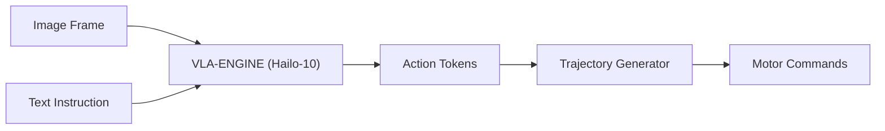

<!-- =============================================================================
HYDRA-UMC-VLA-ENGINE - Vision-language-action engine contracts
Copyright (C) JuanenRac (Electro Hobby 3D) <electrohobby3d@gmail.com>
GPL-3.0-or-later - see LICENSE
============================================================================= -->

<p align="center">
  
</p>

# 🤖 HYDRA-UMC-VLA-ENGINE

<p align="center"><a href="README.md">🇺🇸 English</a> | <a href="README_spa.md">🇪🇸 Español</a> | <a href="README_fra.md">🇫🇷 Français</a> | <a href="README_ita.md">🇮🇹 Italiano</a> | <a href="README_deu.md">🇩🇪 Deutsch</a> | <a href="README_zho.md">🇨🇳 简体中文</a> | 🇯🇵 <b>日本語</b> | <a href="README_por.md">🇵🇹 Português</a></p>

### 🤖 ロボティクス向けマルチモーダル視覚言語行動フレームワーク

<p align="center">
  
  
  
  
  
  
</p>

---

> **安全性とセキュリティの現状:** このエコシステムは認証された安全システムではありません。ハードウェアの E-STOP 経路、ファームウェアが強制する制限やインターロック、検証済みの動作コマンドはまだありません。ファームウェアイメージは CRC-32 と Ed25519 署名で検査し、リリースビルドは公開済みの開発用鍵を拒否します(リレーの先のツールヘッドと拡張ボードは引き続き URTC のブートローダーを使い、署名ではなく共有鍵の HMAC-SHA256 を使います)。TLS と相互 TLS は任意で、既定では無効です。独自基板はまだ実装も試験もされていません。ここに書かれた内容を人の安全のために頼る前に、[セキュリティベースライン](https://github.com/JuanenRac/HYDRA-UMC-DOCS/blob/main/docs/SECURITY_BASELINE.md)と[脅威モデル](https://github.com/JuanenRac/HYDRA-UMC-DOCS/blob/main/docs/THREAT_MODEL.md)をお読みください。

---

## 📋 ひと目で

| | |
|---|---|
| バージョン | `0.1.8` |
| 成熟度 | 機能する |
| テスト | 155 (`python -m pytest -q tests`) |
| 技術 | Python / Vision-Language-Action model |
| 対象 | HYDRA-UMC セルの Raspberry Pi CM5 |
| 実機での確認 | まだです：このバージョンについて実機での動作記録はありません |

**移動：** [概要](#-概要) · [アーキテクチャ](#-アーキテクチャ) · [セキュリティと安全](#-セキュリティと安全) · [クイックスタート](#-クイックスタート) · [テスト](#-テスト) · [リポジトリの構成](#-リポジトリの構成) · [関連プロジェクト](#-関連プロジェクト)

## 🚦 プロジェクトの状況

各行はこのリポジトリの一部分で、信号は今日どこまで進んでいるかを示します。計画ではなく、リポジトリが示せるもの（テスト、ビルド、実行）に基づいて書かれています。

🟢 完了・検証済み · 🟡 動作する（既知の制限あり） · 🟠 一部のみ、または未検証 · 🔴 未実装または動作しない

| 領域 | 状態 | ここでの意味 |
|---|---|---|
| ソフトウェア | 🟡 | 主な目的では動作します。足りない点は上の正直さの確認に書かれています |
| テスト | 🟢 | 自動テスト 155 件。変更のたびに実行されます |
| 実機 | 🔴 | まだです：このバージョンについて実機での動作記録はありません |
| ドキュメント | 🟢 | 8 言語の README。変更のたびにマニフェストと照合されます |

## 🎯 概要

**HYDRA-UMC-VLA-ENGINE** は、視覚的な文脈と自然言語を直接的なロボット動作に変換するマルチモーダルな橋渡し役を目指しています。OpenVLA や RT-2 の特化版などの最先端 VLA モデルの量子化版を、Hailo-10 NPU 上でローカル実行する構想です(計画中:モデルは未選定で、Hailo-10 での推論もまだありません)。

目標は、カメラ映像を解析して対応する運動学的シーケンスを生成することで、「青い部品を取って赤いトレイに置いて」のような指示をロボットが理解できるようにすることです。現時点のエンジンは、アクショントークンの符号化・復号と、固定された範囲内での軌道の積分を行うだけで、言語も画像も理解しません。

### 主な機能：
* 🔑 **任意の Bearer トークン：** ループバックでは API にトークンは不要で、ループバック以外ではトークンなしでは起動しません（`--token-file` または `HYDRA_UMC_VLA_ENGINE_TOKEN`）。トークンを設定すると、すべてのリクエストが `Authorization: Bearer <token>` を送る必要があります（一定時間での比較）。マニフェストのヘルスパスである `GET /health` だけは開いたままです。*(実装済み)*
* ✅ **実装済み v0 —— アクショントークンと軌道：** `action_tokens.py` は OpenVLA/RT-2 スタイルの 256 ビン離散化スキーム（連続アクション <-> 離散トークン、7 自由度のアクション空間——姿勢差分 + グリッパー——に基づく）を実装し、`trajectory.py` はデコードされたアクションシーケンスを絶対姿勢の軌道へと積分します。下記の `tokens encode`/`tokens decode`/`trajectory integrate` から利用可能で、実行にもテストにも VLA モデルや Hailo-10 NPU は不要です。
* 🧯 **数値でないものが動作になることはありません：** `encode_action` は NaN と無限大を拒否します（NaN をクランプすると上限が選ばれ、モデルが NaN を出力するとすべての軸で最大動作としてエンコードされていました）。2〜65536 の範囲外の `vocab_size` は拒否され、HTTP API は JSON リテラルの `NaN`/`Infinity` と文字列 `"nan"`/`"inf"` を `400` で拒否します。*（実装済み）*
* 📜 **モデルマニフェストと出力検証：** 将来のあらゆるモデル統合が満たすべき、実際にバージョン管理された契約（`model_manifest.py`）——アクション/語彙の形状と既知の Hailo チップファミリーに一致すること——に加え、モデルの生の推論出力に対する形状/信頼度の検証を提供します。*(実装済み)*
* 🚧 **軌道ガード:** `guard.py` は、誰かに承認を求める前に、軌道をセルの制限に照らして検査します。作業空間、最長のステップ(メートルとラジアン)、前のステップとの差の上限、グリッパーの範囲、そして HYDRA-UMC-SAFETY-ZONES のゾーン(同じ JSON 形式)です。`danger` ゾーンに入る、または横切る動きは軌道を拒否し、`warning` ゾーン内のステップは一定の割合に制限されます。結果は `ok`、`clamped`(ステップを切り詰め、残りを切り詰め位置から再積分)、`rejected`(姿勢は提示されず `422`)のいずれかです。`serve --guard-file ファイル`(または `HYDRA_UMC_VLA_GUARD_FILE`)で `POST /trajectory/integrate` に有効化し、`--require-guard` はガードなしでは何も提示せず、`trajectory integrate --guard-file` はコマンドラインで同じことをします。提案が何かを認可することはありません。*(合成軌道で試験済み、モデルも機械も使っていません)*
* 🔌 **モジュールに先立って準備されたHailoRT統合境界：** `hailo_runtime.py` は、実際の確認済み `hailo_platform` API(`VDevice`、`HEF`、`ConfigureParams`、`InputVStreamParams`/`OutputVStreamParams`)に対して書かれています —— `hailort` パッケージやHailo-10モジュールが存在しなくてもこのリポジトリがクリーンにインストール/テストできるよう遅延インポートされており、`hailo_output_to_tokens()`(実際の推論結果を本エンジン自身のトークン契約にマッピングする部分)は現時点で完全にユニットテスト済みです。*(実装済み、統合境界のみ —— 詳細は下記)*
* 🩺 **正直な `status` サブコマンド：** 実際のアクセラレータ/モデルの重みの可用性を報告します——`no_accelerator`、`no_model_weights`、または `hardware_ready_no_inference`——偽の「準備完了」状態を返すことは決してありません。*(実装済み)*
* 🌉 **セマンティック制御（計画中）：** ピクセルとテキストから関節位置や工具コマンドへの直接マッピング。*（実際の VLA モデルが必要——将来の作業。）*
* ⚡ **リアルタイム推論（計画中）：** 低遅延の動作生成を実現する Hailo-10 アクセラレーション推論。*（この環境にはない実際の Hailo-10 NPU が必要です。）*
* 🔄 **ゼロショット汎化（計画中）：** 意味的な記述に基づいて未知の物体を扱うことが可能。*（実際に学習済みの VLA モデルが必要です。）*
* 🛠️ **タスクプランニング（計画中）：** 複雑な目標を原子レベルのロボットプリミティブへと分解。*（実際の VLA モデルが必要です。）*
* 👨‍👩‍👧 **認知 AI ノードの子プロジェクト：**
  [HYDRA-UMC-COGNITIVE-NODE](https://github.com/JuanenRac/HYDRA-UMC-COGNITIVE-NODE) の下で 4 つの兄弟サービスの 1 つとして動作します（Voice-UI、Semantic-Planner、Docs-QA と並んで）。独自のコピーを保持するのではなく、親プロジェクトの HydraOS イメージとモデルの重みを共有します。

## 🧩 HYDRA-UMC での役割

**HYDRA-UMC-VLA-ENGINE** は、モデルを必要としない視覚・言語・行動エンジンの部分を収めています。行動と離散トークンの相互変換、予測ステップの軌道への積分、作業空間・速度制限・安全ゾーン・グリッパー範囲に対して軌道を切り詰めるか拒否するガードです。モデルはまだ動かず、Hailo-10 との境界は存在するものを報告するだけです。

## 🏛️ アーキテクチャ

<p align="center">
  
</p>

<details>
<summary>図のテキスト版（Mermaid）</summary>



</details>

### アーキテクチャと設計上の決定

本リポジトリは Cognitive AI Node ファミリーの**子プロジェクト**です——
親プロジェクトである [HYDRA-UMC-COGNITIVE-NODE](https://github.com/JuanenRac/HYDRA-UMC-COGNITIVE-NODE) が共有の HydraOS イメージと量子化モデルの重みを保持し、本サービスを他の 3 つの兄弟プロジェクト（Voice-UI、Semantic-Planner、Docs-QA）とともに `docker-compose.yml` に接続します：

* **本子プロジェクトに独自のハードウェア/ファームウェア/`os/`/`models/` がない理由。** 親プロジェクトが既に保有する CM5 + Hailo-10 M.2 モジュール上で完全に動作します——モデルの重みと HydraOS イメージを 1 か所に集約することで、ファミリー全体で数 GB にも及ぶモデルの重みが 4 つの食い違ったコピーとして存在することを避けられます。
* **`src/` レイアウトを採用した理由。** インストール可能なパッケージ（`hydra_umc_vla_engine`）をリポジトリルートのツール（`bump_version.py`）から分離し、エコシステム内の他のすべての Python プロジェクトで使用されているレイアウトと一致させるためです。
* **アクショントークン化がモデル推論より先に実装される理由。** 連続アクションを離散トークンに変換する（そしてその逆を行う）ことは、アクション空間の境界とボキャブラリサイズによって定義される固定の数学であり、記述にもテストにも VLA モデルや Hailo-10 NPU は不要です。そのため v0 ではこの部分（`action_tokens.py`、`trajectory.py`）が先に実装されます。実際の VLA 推論にはこの環境にないモデルの重みと Hailo-10 ハードウェアが必要で、後で実装されます。
* **`hailo_runtime.py` が `hailo_platform` を、わずか2つの関数の中でのみ遅延インポートする理由。** `hailort` は PyPI に存在せず、この開発マシンにもインストールされていません —— モジュールの読み込み時にインポートすると、実際のHailoモジュールが接続されたマシン以外のあらゆる場所で、このパッケージ全体がインストール/インポートに失敗してしまいます。実際にHailoRTを必要とする2つの関数、`open_vdevice()` と `load_hailo_vla_model()` だけがそれを、しかも遅延的にインポートします。両方とも、欠落している場合には単なる `ImportError` ではなく明確な `HailoNotAvailableError` を送出します。これは、このエコシステムがすでに他のあらゆる実際のハードウェアトランスポート(GRBLシリアル、MAVLink、SPI-OTA……)に対して使用しているのと同じパターンです。
* **エコシステムの他の部分との関係。** 本エンジンは、生の知覚データ（概念上は上流の HYDRA-UMC-VISION-NODE から転送されるカメラフレーム）と自然言語による指示を動作トークンへと変換し、その兄弟プロジェクトである HYDRA-UMC-SEMANTIC-PLANNER がこれを HYDRA-UMC-ORCHESTRATOR 向けのミッションレベルの決定へと変換します。 *（計画中:現時点ではエンジンはカメラ画像もテキストも受け取らず、その出力を使うのは HYDRA-UMC-SERVER の汎用プロキシだけです。）*
* **`model_manifest.py` が特定の OpenVLA/RT-2 バリアントを指定しない理由。** 実際にはまだどのモデルも選定されていません（本 README 自身のロードマップを参照）——`EXPECTED_MODEL_MANIFEST` は、`action_tokens.py` 自身の実際の定数から直接導出された、正直なところ形状/ターゲットの契約であり、存在しないモデルのためのローダーではありません。`hailo_arch` は、`HYDRA-UMC-DETECTION-HEF` が自身のモデルレジストリの検証に既に使用しているのと同じ、実際の閉じたチップファミリーの集合を再利用します。
* **`status` が「準備完了」ではなく `hardware_ready_no_inference` を報告する理由。** 実際の Hailo-10 デバイスと実際のモデルの重みの両方が揃ったとしても、この v0 にはまだ実際の推論コードがありません——その時点で準備完了だと主張することは、まだ存在しない能力についての本当の嘘になってしまいます。`hardware.py` の `determine_mode()` は、モデルの重みより先にアクセラレータ（安価なデバイスノードのプローブ）を確認します。これは `HYDRA-UMC-DETECTION-HEF` の `safe_load()` が既に採用しているのと同じ、「最も安価な前提条件を最初に確認する」という順序です。
* **`model_weights_available()` がローカルの `models/` ではなく親プロジェクトの `models/` を確認する理由。** この子プロジェクトには独自の `models/` がありません（省略されています——上記の項目を参照）——実際の共有された重みは、兄弟ワークスペースを 1 段階上がった親プロジェクト `HYDRA-UMC-COGNITIVE-NODE` 自身の `models/` に存在します。これは、そのリポジトリ自身の `check_shared_models()` が既に確認しているのと同じ実際のディレクトリです。

## 🔒 セキュリティと安全

軌道の提案には署名を付けられます（既定ではオフ）。`serve --proposal-key-file FILE --robot-id ROBOT [--proposal-valid-seconds N]` を指定すると、`POST /trajectory/integrate` が返す内容に `robot_id`、`issued_at_ms`、`expires_at_ms`、HMAC-SHA256 の `signature` が加わります（有効時間は既定 60 秒、最長 600 秒）。`verify_proposal()` は、改変された、期限切れの、未来の日時の、または別のロボット向けの提案を拒否します。提案は依然として命令ではありません。鍵（16 バイト以上）はインストール先のファイルに置き、リポジトリには決して置きません。 リクエストに `--model-version V` と `instruction_sha256`（指示の SHA-256）を与えると、この二つも署名され、`verify_proposal()` で必須にできます。承認を別のモデルの提案や別の指示の提案へ移し替えることはできません。

## 🚀 クイックスタート

Python 3.10 以上が必要です。

```bash
./build.sh  # Linux, macOS (build.bat on Windows)
./run.sh tokens encode --action 0.02,0.00,-0.01,0.0,0.0,0.05,1.0
./run.sh trajectory integrate --start 0,0,0,0,0,0 --actions actions.json
./run.sh status
./run.sh serve --port 8098
```

## 🧪 テスト

`python -m pytest -q tests` で自動テスト 155 件を実行します。 ハードウェアも、このマシンの外にあるものも必要ありません。

CI は `HYDRA_UMC_CI=1 python tools/ci_validate.py` を実行し、マニフェスト、文書、8 つの README、図を検査します。

## 🏗️ ビルドとリリース

Python >= 3.10 が必要です。

```bash
# Linux / macOS / Git Bash
./build.sh   # .venv を作成し、パッケージを（editable モード、dev
             # エクストラ付きで）インストールし、インポートを検証し、
             # 実際のテストスイートを実行します
./run.sh     # エントリポイントを実行します

# Windows (cmd)
build.bat
run.bat
```

`build.sh`/`build.bat` はバージョンを変更しません（上げるのは `python tools/hydra_project_tool.py bump` だけです）。`run.sh`（素の呼び出し）
の予期される出力：

```text
HYDRA-UMC-VLA-ENGINE v0.1.8
Vision-Language-Action engine (Hailo-10) - translates camera frames and text instructions into robotic action sequences.
```

実際の例 —— アクションをトークンにエンコードし、デコードして戻し、短いアクションシーケンスを軌道に積分する：

```bash
./run.sh tokens encode --action "0.02,-0.03,0.01,0.05,-0.04,0.02,0.7"
# 179,51,153,192,76,153,179

./run.sh tokens decode --tokens "179,51,153,192,76,153,179"
# 0.020117,-0.029883,0.009961,0.050391,-0.040234,0.019922,0.701172
# （上記のエンコード入力とは一致しない — 256 ビンの離散化は設計上
# 情報損失を伴い、decode はビンの中点を復元するのであって、元の値
# そのものではない）

echo '[[0.01, 0.0, 0.0, 0.0, 0.0, 0.0, 0.5], [0.0, 0.01, 0.0, 0.0, 0.0, 0.0, 1.0]]' > actions.json
./run.sh trajectory integrate --start "0,0,0,0,0,0" --actions actions.json
# step 0: x=0.000000 y=0.000000 z=0.000000 roll=0.000000 pitch=0.000000 yaw=0.000000 gripper=0.000000
# step 1: x=0.010000 y=0.000000 z=0.000000 roll=0.000000 pitch=0.000000 yaw=0.000000 gripper=0.500000
# step 2: x=0.010000 y=0.010000 z=0.000000 roll=0.000000 pitch=0.000000 yaw=0.000000 gripper=1.000000
```

`status` は、実際の、正直なアクセラレータ/モデルの重みの可用性を報告します——偽の準備完了状態を返すことは決してありません：

```text
$ ./run.sh status
accelerator (Hailo-10):    MISSING
model weights (parent):    MISSING
mode: no_accelerator - no Hailo-10 NPU device node on this machine - real inference cannot run here.
```

### 🩺 トラブルシューティング

* **`python: command not found` / ビルドがステップ 1 で失敗する。** `PATH` 上に Python >= 3.10 が必要です。Windows では [python.org](https://python.org) からインストールし、セットアップ中に「Add to PATH」がチェックされていることを確認してください。Linux/macOS では通常 `python3` という名前が使われます。
* **`build.sh` が venv をアクティブ化できない。** `python3 -m venv .venv` は、プラットフォームごとに異なる場所にアクティベートスクリプトを配置します：Linux/macOS では `.venv/bin/activate`、Windows（Git Bash から使用される Windows Python venv でも同様）では `.venv/Scripts/activate`。`build.sh` は既に両方のパスをチェックしています——それでも失敗する場合は、`.venv/` を削除して `./build.sh` を再実行し、ゼロから再構築してください。
* **`pip install -e .` が失敗する。** 通常は `.venv/` が古くなっていることが原因です。`.venv/` フォルダを削除して `./build.sh`/`build.bat` を再実行し、再作成してください。
* **`import OK` が一度も表示されない。** `python -c "import hydra_umc_vla_engine"` 自体が失敗したことを意味します——venv がアクティブな状態で再実行し、実際のトレースバックを確認してください。

## 📂 リポジトリの構成

<p align="center">
  
</p>

<details>
<summary>ツリーのテキスト版</summary>

```text
HYDRA-UMC-VLA-ENGINE/
├── src/hydra_umc_vla_engine/   ソースコード
│   ├── __init__.py             パッケージの説明とバージョン
│   ├── access.py               HTTP API 用の任意の Bearer トークン (ループバックでは不要、それ以外では必須)
│   ├── action_tokens.py        アクション <-> トークン離散化（OpenVLA/RT-2 スタイル）
│   ├── trajectory.py           アクションシーケンス -> 姿勢軌道の積分
│   ├── guard.py                軌道ガード:作業空間、ステップ制限、ゾーン
│   ├── model_manifest.py       実際のモデル形状契約 + 推論出力検証
│   ├── hardware.py             実際のアクセラレータ/モデルの重みの可用性プローブ
│   ├── hailo_runtime.py        実際のHailoRT(hailo_platform)統合境界、遅延インポート
│   ├── api.py                  シンプルなJSON/HTTPサーフェス(stdlibのhttp.server)。tokens/trajectory/statusを橋渡し
│   └── main.py                 CLI エントリポイント（素の呼び出し + `tokens`/`trajectory`/`status`）
├── tests/                      実際の pytest スイート（action_tokens、trajectory、manifest、hardware、hailo_runtime、api、CLI）
├── docs/                       ドキュメントとベンチマーク
├── images/                     メディアと図表
├── systemd/                    サービスユニット
├── tools/                      プロジェクトのツールと CI の検査
├── .github/                    CI ワークフローと Issue テンプレート
├── pyproject.toml              パッケージのメタデータ
├── bump_version.py             明示的なバージョン更新
├── bump_manifest_version.py    hydra-umc.project.json のバージョンをネイティブ版と同期(--sync)
├── build.sh / build.bat        venv 作成、インストール（dev エクストラ付き）、インポート検証、テスト実行
├── run.sh / run.bat            エントリポイントを実行
├── CHANGELOG.md                各バージョンの変更点
├── Dockerfile                  コンテナイメージ
├── build-test.sh               変更を伴わないビルド確認
├── hydra-umc.project.json      マニフェスト：バージョン、成熟度、ファミリー
└── test.sh                     テストを実行
```

</details>

## 🗺️ ロードマップと既知の制限

**現時点の既知の制限**

### 現在の状況と次のステップ

**現在実装済み：** アクショントークンのエンコード/デコードと軌道生成(`action_tokens.py`、`trajectory.py`)——上のフロー図の「アクショントークン」と「軌道生成器」のステップ——に加えて、実際の `.hef` モデルとHailo-10モジュールが存在し次第使えるように準備された実際のHailoRT統合境界(`hailo_runtime.py`)。テストは98個と実際のCLI。

**まだ先で、実際のハードウェア/実際のモデルに阻まれている：** 実際に推論を実行するには、実際にコンパイルされたVLA `.hef` モデル(Hailo-10向けに量子化されたOpenVLA/RT-2——まだ具体的なモデルは選定されていません)と、接続された物理的なHailo-10モジュールが必要です。どちらも `hailo_runtime.py` 単体では取り除けない、実在する避けられないブロッカーです——しかし、モデルが存在するようになれば、それを読み込んでデコードすること自体はもはや未実装のコードではありません。

### ロードマップ

* **フェーズ 1：** Hailo-10 上での VLA エンジンのデプロイとマルチモーダル入力処理。
* **フェーズ 2：** 意味プランナーと群行動モデルおよび長期記憶の統合。
* **フェーズ 3：** 音声 UI の低遅延ローカル実行と産業用ノイズキャンセリング。
* **フェーズ 4：** デュアルアーム協調動作生成のサポートと自律的意思決定の監査。

## 🌍 言語

この README とリポジトリの文書は、英語・スペイン語・ドイツ語・フランス語・イタリア語・日本語・中国語・ポルトガル語（ポルトガル）の 8 言語で提供されています。8 つのファイルは同時に書かれ、同じ節と同じリンクを持つことを CI が確認します。 このリポジトリには独自の画面もメッセージカタログもないため、翻訳すべきインターフェース文字列はありません。

## 🔗 関連プロジェクト

本プロジェクトは、同じ作者(JuanenRac / Electro Hobby 3D)による HYDRA-UMC ロボティクスエコシステムの一部です。リクエストが実はこの中のどれかについてのものである可能性があるため、知っておく価値があります。

**親プロジェクト**
- **[HYDRA-UMC-COGNITIVE-NODE](https://github.com/JuanenRac/HYDRA-UMC-COGNITIVE-NODE)** — Hailo-10 コグニティブパイプライン(LLM/VLA/音声オーケストレーション)の統合ハブ。本リポジトリは、その自身のコグニティブパイプライン内における特定の段階・消費者として、この親の一部を成す。

**兄弟プロジェクト** —— HYDRA-UMC-COGNITIVE-NODE 自身の Hailo-10 コグニティブパイプラインにおける他の段階・消費者
- **[HYDRA-UMC-VOICE-UI](https://github.com/JuanenRac/HYDRA-UMC-VOICE-UI)** — 確認ゲート付きの限定的な Watch リレーを備えた、実際の音声フロントエンド(VAD + 意図解析)。
- **[HYDRA-UMC-SEMANTIC-PLANNER](https://github.com/JuanenRac/HYDRA-UMC-SEMANTIC-PLANNER)** — MCU エラーコードに対する、実際のルールベースのタスク分解と意味的エラー復旧。
- **[HYDRA-UMC-DOCS-QA](https://github.com/JuanenRac/HYDRA-UMC-DOCS-QA)** — このエコシステム自身の Markdown ドキュメントに対する、標準ライブラリのみの実際の TF-IDF 文書検索。
- **[HYDRA-UMC-LOCAL-TECHNICIAN](https://github.com/JuanenRac/HYDRA-UMC-LOCAL-TECHNICIAN)** — エコシステム自身のための、ローカルでポリシーゲート付きのAIメンテナンス技術者 — 観察、診断し、修正を提案する;最上位の2つのリスクレベルは意図的にまだ実装されていない。

**エコシステムの他のプロジェクト**

*コアハードウェア&プラットフォーム*
- **[HYDRA-UMC](https://github.com/JuanenRac/HYDRA-UMC)** — ロボットアームのマザーボードの設計——CM5 ホスト + デュアルコア STM32H745、CAN-OTA/SPI-OTA 経由で最大 8 本のツールアームを統括することを目指す(ファームウェアは初期段階で、実装済みの基板はまだない)。
- **[HYDRA-UMC-OS](https://github.com/JuanenRac/HYDRA-UMC-OS)** — CM5 向けの再現可能な Raspberry Pi OS プロダクト層——読み取り専用エージェント、検証済み設定/プロファイル、WiFi 初回接続プロビジョニング。
- **[HYDRA-UMC-SDK](https://github.com/JuanenRac/HYDRA-UMC-SDK)** — すべてのブリッジが自身のコマンドを検証する共有 JSON-Schema 契約とソフトウェアのジョブゲート境界(認証済みの安全機能ではない)。
- **[HYDRA-UMC-CONNECTOR-HUB](https://github.com/JuanenRac/HYDRA-UMC-CONNECTOR-HUB)** — 外部マシン用コネクタのための宣言的アダプターマニフェストのレジストリとバリデーター。SDK 自身の契約という発想を外部マシンにまで拡張し、産業用ゲートウェイ系のプロジェクトを置き換えることはありません。

*コアバックエンド&クライアント*
- **[HYDRA-UMC-SERVER](https://github.com/JuanenRac/HYDRA-UMC-SERVER)** — すべての制御クライアントが実際に通信する、本物のヘッドレスバックエンド(REST/WebSocket)。
- **[HYDRA-UMC-STUDIO](https://github.com/JuanenRac/HYDRA-UMC-STUDIO)** — リアルタイムのマルチロボット 3D 可視化を備えたウェブ制御ダッシュボード。
- **[HYDRA-UMC-SUITE](https://github.com/JuanenRac/HYDRA-UMC-SUITE)** — 複数のサーバーを同時に扱えるデスクトップ(PySide6)スウォームコマンドセンター、スタンドアロン実行ファイルとしてパッケージ化。
- **[HYDRA-UMC-ANDROID-CONTROL](https://github.com/JuanenRac/HYDRA-UMC-ANDROID-CONTROL)** — 生体認証ログインとペアリングされた Wear OS コンパニオンを備えたネイティブ Android 制御アプリ。
- **[HYDRA-UMC-IOS-CONTROL](https://github.com/JuanenRac/HYDRA-UMC-IOS-CONTROL)** — リアルタイム WebSocket 同期を備えた iOS/iPadOS 制御アプリ(Flutter)。
- **[HYDRA-UMC-DSI](https://github.com/JuanenRac/HYDRA-UMC-DSI)** — 本体搭載の 7 インチ DSI タッチスクリーン向けネイティブタッチ UI、CM5 自体に組み込み。
- **[HYDRA-UMC-EDITOR-URDF](https://github.com/JuanenRac/HYDRA-UMC-EDITOR-URDF)** — 完成したモデルを STUDIO 自身のカタログへ送信するデスクトップ用グラフィカル URDF 作成/編集ツール。
- **[HYDRA-UMC-EDITOR-STL](https://github.com/JuanenRac/HYDRA-UMC-EDITOR-STL)** — HYDRA-UMC-EDITOR-URDF も編集する同じモデルカタログ内で、実在するパーツを変換/置換/削除/追加するデスクトップ STL モデルエディタ。
- **[HYDRA-UMC-BRIDGE-AMR](https://github.com/JuanenRac/HYDRA-UMC-BRIDGE-AMR)** — VDA 5050 MQTT パブリッシャーによる AGV/AMR フリートの調整境界(エミュレートしたフリートに対してのみテスト済み)。
- **[HYDRA-UMC-BRIDGE-CNC](https://github.com/JuanenRac/HYDRA-UMC-BRIDGE-CNC)** — GRBL ステータス/制御バイトへのアクセスを持つ、CNC セルの高レベルコーディネーター(エミュレーターに対してのみテスト済み)。
- **[HYDRA-UMC-BRIDGE-DROIDS](https://github.com/JuanenRac/HYDRA-UMC-BRIDGE-DROIDS)** — Boston Dynamics Spot コマンド送信機能を持つ、脚型/ヒューマノイドドロイドの調整境界(エミュレーターに対してのみテスト済み)。
- **[HYDRA-UMC-BRIDGE-LASER](https://github.com/JuanenRac/HYDRA-UMC-BRIDGE-LASER)** — キー/筐体/インターロックの GPIO 信号 3 系統を読み取るレーザーセルのコーディネーター(模擬チップに対してのみテスト済み。レーザーの武装や発射はできない)。
- **[HYDRA-UMC-BRIDGE-OPENPNP](https://github.com/JuanenRac/HYDRA-UMC-BRIDGE-OPENPNP)** — OpenPnP ピックアンドプレースの基板フローを安全に統括する高レベルコーディネーター。
- **[HYDRA-UMC-BRIDGE-PRINTER3D](https://github.com/JuanenRac/HYDRA-UMC-BRIDGE-PRINTER3D)** — 実際にゲート制御されたジョブコマンドを持つ、Moonraker/Klipper 3D プリンター向けの安全な調整境界。
- **[HYDRA-UMC-BRIDGE-ROS2](https://github.com/JuanenRac/HYDRA-UMC-BRIDGE-ROS2)** — 遅延インポートの rclpy ROS 2 トランスポートを持つコーディネーター(ROS 2 環境ではまだ実行していない)。
- **[HYDRA-UMC-BRIDGE-UAV](https://github.com/JuanenRac/HYDRA-UMC-BRIDGE-UAV)** — MAVLink コマンド送信機能を持つ、カメラ搭載 UAV の調整境界(エミュレーターに対してのみテスト済み)。

*URTC ツールプラットフォーム*
- **[URTC](https://github.com/JuanenRac/URTC)** — 物理的な Universal Robot Tool Controller 基板向けファームウェア、CAN バス経由の 25 以上のツールプロファイル。
- **[URTC-FLASHER](https://github.com/JuanenRac/URTC-FLASHER)** — URTC 基板用のデスクトップ GUI 書き込みツール、CAN-OTA およびフルチップ SWD/JTAG。
- **[URTC-TESTER](https://github.com/JuanenRac/URTC-TESTER)** — URTC 基板向けのデスクトップ CAN バスライブ診断ツール、ツールプロファイルごとに 1 パネル。
- **[URTC-WEB-STUDIO](https://github.com/JuanenRac/URTC-WEB-STUDIO)** — Web Serial API を使ったブラウザベースの URTC-TESTER の代替、ローカルインストール不要。
- **[URTC-GATEWAY](https://github.com/JuanenRac/URTC-GATEWAY)** — URTC の CAN バスの前に置くゲートウェイ：許可する識別子のリスト、レート制限、セッション鍵。コンピューター上でテスト済みで、実際のバスではまだ試していません。

*ビジョン AI ノード(Hailo-8)*
- **[HYDRA-UMC-VISION-NODE](https://github.com/JuanenRac/HYDRA-UMC-VISION-NODE)** — Hailo-8 ビジョンパイプラインの統合ハブ、段階ごとの実際のハードウェア準備状況チェック付き。
- **[HYDRA-UMC-DETECTION-HEF](https://github.com/JuanenRac/HYDRA-UMC-DETECTION-HEF)** — Hailo アーキテクチャ/チェックサムによる安全読み込み検証を備えた、実際のコンパイル済みモデルレジストリ。
- **[HYDRA-UMC-VISION-STREAMER](https://github.com/JuanenRac/HYDRA-UMC-VISION-STREAMER)** — 実際の HailoRT 統合境界を持つ、実際の GStreamer パイプライン + MediaMTX 設定生成器。
- **[HYDRA-UMC-VISUAL-SERVOING-API](https://github.com/JuanenRac/HYDRA-UMC-VISUAL-SERVOING-API)** — ゾーン状態を条件に承認する Position-Based Visual Servoing 補正則。カメラによる姿勢推定はまだない。
- **[HYDRA-UMC-SAFETY-ZONES](https://github.com/JuanenRac/HYDRA-UMC-SAFETY-ZONES)** — ファイルから物体位置を受け取る、ゾーン侵入・キャリブレーション鮮度・E-STOP 要求の v0 ロジック。検出器は接続されておらず、物理 E-STOP もまだ配線されていない。

*オーケストレーション&スウォーム*
- **[HYDRA-UMC-ORCHESTRATOR](https://github.com/JuanenRac/HYDRA-UMC-ORCHESTRATOR)** — 実際の gRPC/Protobuf ヘルスレポート契約とミッションステートマシンを持つ統合ハブ。
- **[HYDRA-UMC-JOB-DISPATCHER](https://github.com/JuanenRac/HYDRA-UMC-JOB-DISPATCHER)** — 実際の HTTP API 上に構築された、優先度ベースの実際のジョブキュー(重複排除付き)。
- **[HYDRA-UMC-NODE-HEALING](https://github.com/JuanenRac/HYDRA-UMC-NODE-HEALING)** — リトライ/バックオフとアイデンティティ不一致検出を備えた、実際の gRPC ベースのフリートヘルスウォッチドッグ。
- **[HYDRA-UMC-PATH-PLANNER-3D](https://github.com/JuanenRac/HYDRA-UMC-PATH-PLANNER-3D)** — 実際の障害物/ワークスペース衝突検証を備えた、実際の RRT ベースの 3D 経路プランナー。
- **[HYDRA-UMC-SWARM-SYNC](https://github.com/JuanenRac/HYDRA-UMC-SWARM-SYNC)** — 複数セルの収束についてプロパティテストされた、実際の CRDT LWW-Element-Map 状態同期。

*デジタルツイン&シミュレーション*
- **[HYDRA-UMC-TWIN](https://github.com/JuanenRac/HYDRA-UMC-TWIN)** — 実際のバージョン互換性同期契約を持つ、デジタルツインエンジンの統合ハブ。
- **[HYDRA-UMC-HIL-BRIDGE](https://github.com/JuanenRac/HYDRA-UMC-HIL-BRIDGE)** — シミュレーションと実機の間にソフトウェアの衝突インターロックを備えたハードウェア・イン・ザ・ループのルーター(実機なしでテスト済み)。
- **[HYDRA-UMC-PHYSICS-REPLICA](https://github.com/JuanenRac/HYDRA-UMC-PHYSICS-REPLICA)** — 実際の URDF サブセットに対する、実際の順運動学と関節限界検証。
- **[HYDRA-UMC-SYNTHETIC-DATA-GEN](https://github.com/JuanenRac/HYDRA-UMC-SYNTHETIC-DATA-GEN)** — YOLO/COCO アノテーションのエクスポート機能を持つ、実際のプロシージャル 2D シーンジェネレーター。

*データ&分析*
- **[HYDRA-UMC-DATALAKE](https://github.com/JuanenRac/HYDRA-UMC-DATALAKE)** — 実際の取り込み/クエリ HTTP API を備えた、実際の sqlite3 ベースの時系列ストア。
- **[HYDRA-UMC-ANOMALY-DETECTOR](https://github.com/JuanenRac/HYDRA-UMC-ANOMALY-DETECTOR)** — ドリフト監視を備えた、実際の FFT + 統計ベースラインによる異常検知器。
- **[HYDRA-UMC-PRODUCTION-REPORTS](https://github.com/JuanenRac/HYDRA-UMC-PRODUCTION-REPORTS)** — DATALAKE の履歴に対する実際の OEE/稼働率計算、再現可能な CSV エクスポート付き。
- **[HYDRA-UMC-TELEMETRY-COLLECTOR](https://github.com/JuanenRac/HYDRA-UMC-TELEMETRY-COLLECTOR)** — シーケンス重複排除機能を備えた、DATALAKE への実際の CAN/WebSocket 取り込みパイプライン。

*産業用ゲートウェイ*
- **[HYDRA-UMC-GATEWAY-INDUSTRIAL](https://github.com/JuanenRac/HYDRA-UMC-GATEWAY-INDUSTRIAL)** — 実際のコマンド許可リスト/バックプレッシャー層を持つ、産業用プロトコルへ中継する統合ハブ。
- **[HYDRA-UMC-OPCUA-SERVER](https://github.com/JuanenRac/HYDRA-UMC-OPCUA-SERVER)** — 実際のバイナリプロトコルクライアントセッションで検証された、実際の OPC-UA アドレス空間。
- **[HYDRA-UMC-MQTT-BROKER](https://github.com/JuanenRac/HYDRA-UMC-MQTT-BROKER)** — クライアント単位のオプション認証とトピック ACL を備えた、実際の MQTT ブローカー。
- **[HYDRA-UMC-MTCONNECT-ADAPTER](https://github.com/JuanenRac/HYDRA-UMC-MTCONNECT-ADAPTER)** — 縮退モード出力を備えた、実際の MTConnect `/probe` および `/current` XML エンドポイント。

*補完ツール&エコシステム運用*
- **[HYDRA-UMC-DASHBOARD-AI](https://github.com/JuanenRac/HYDRA-UMC-DASHBOARD-AI)** — 誠実な統計フォールバックを備えた、DATALAKE/ANOMALY-DETECTOR 上のスマートサマリーと異常ハイライトパネル。
- **[HYDRA-UMC-TOOL-CLI](https://github.com/JuanenRac/HYDRA-UMC-TOOL-CLI)** — 実際の安定した終了コード契約を持つフリート CLI、HYDRA-UMC-SERVER 自身の API の本物のライブクライアント。
- **[HYDRA-UMC-WATCH](https://github.com/JuanenRac/HYDRA-UMC-WATCH)** — 触覚アラートのパターンとペアリング済みスマートフォンへの音声リレーを備えた WearOS コンパニオンアプリ(物理的なウォッチではまだ実行していない)。
- **[URTC-SMART-RACK](https://github.com/JuanenRac/URTC-SMART-RACK)** — 実際の工具 ID デコードと Smart Idle 予熱ロジックを備えた、基板搭載ラック用ファームウェア。
- **[URTC-VISION-TOOL](https://github.com/JuanenRac/URTC-VISION-TOOL)** — サーマル/RGB 検査ツールヘッド向けの、ファームウェアと実際の Python ビジョンコンパニオン。
- **[HYDRA-UMC-UPDATER](https://github.com/JuanenRac/HYDRA-UMC-UPDATER)** — このエコシステム内のすべてのリポジトリを検出・クローン・更新する、管理用デスクトップツール。
- **[HYDRA-UMC-OS-REBUILDER](https://github.com/JuanenRac/HYDRA-UMC-OS-REBUILDER)** — エコシステムの最新バージョンをプリロードした、書き込み可能なCM5イメージを構築するWindows/Linuxデスクトップツール。Raspberry Pi Imager方式の初回起動Wi-Fi/ユーザー/SSH設定を備える。
- **[HYDRA-UMC-OPS-AGENT](https://github.com/JuanenRac/HYDRA-UMC-OPS-AGENT)** — 保守インシデントコーディネーター: 低権限のエッジ役割がサニタイズされたインベントリ/ヘルスのスナップショットを収集し、コントロールプレーン役割がそれを読み取り専用でレンダリングして AI プロバイダーに診断の提案を依頼します - パッチを適用することも、何かをデプロイすることも決してありません。
- **[HYDRA-UMC-DEV-SERVER](https://github.com/JuanenRac/HYDRA-UMC-DEV-SERVER)** — 再現可能な開発ホスト（Raspberry Pi 5 / CM5）。エコシステムのソースコードを保管し、永続キューのもとで境界の明確なビルド/テストタスクを実行する。運用中の CM5 とは明確に異なる、開発専用の役割。

## 📚 ドキュメント

さらに読むには：

* [エコシステムのセキュリティ基準](https://github.com/JuanenRac/HYDRA-UMC-DOCS/blob/main/docs/SECURITY_BASELINE.md)
* [エコシステムの脅威モデル](https://github.com/JuanenRac/HYDRA-UMC-DOCS/blob/main/docs/THREAT_MODEL.md)
* [このリポジトリの変更履歴](CHANGELOG.md)
* [このリポジトリのライセンス](LICENSE.md)

## 🤝 コントリビュートとコミュニティ

* プルリクエストの前に `HYDRA_UMC_CI=1 py -3 tools/ci_validate.py`（または `HYDRA_UMC_CI=1 python3 tools/ci_validate.py`）を実行してください。`CI_VALIDATION=PASS` と表示される必要があります。この確認に `build.sh` や `build.bat` は使わないでください。ビルドは検査ではありません。
* 8 つの README は HYDRA-UMC-DOCS の 1 つのソースから書かれます。手で編集しないでください。ソースを変更し、`tools/make_readmes.py` で書き直します。
* 実行していないことを README に書かないでください。事実であれば「シミュレーションのみ」「実機では未確認」と書きます。
* [CONTRIBUTING.md](CONTRIBUTING.md)、[行動規範](CODE_OF_CONDUCT.md)、[SECURITY.md](SECURITY.md)、[SUPPORT.md](SUPPORT.md) を参照してください。

## 👤 作者

**JuanenRac (Electro Hobby 3D)** · electrohobby3d@gmail.com

## 📜 ライセンス

GPL-3.0-or-later - [LICENSE](LICENSE).
