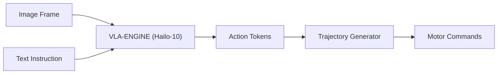

<!-- =============================================================================
HYDRA-UMC-VLA-ENGINE - Vision-language-action engine contracts
Copyright (C) JuanenRac (Electro Hobby 3D) <electrohobby3d@gmail.com>
GPL-3.0-or-later - see LICENSE
============================================================================= -->

<p align="center">
  
</p>

# 🤖 HYDRA-UMC-VLA-ENGINE

<p align="center"><a href="README.md">🇺🇸 English</a> | <a href="README_spa.md">🇪🇸 Español</a> | <a href="README_fra.md">🇫🇷 Français</a> | <a href="README_ita.md">🇮🇹 Italiano</a> | <a href="README_deu.md">🇩🇪 Deutsch</a> | <a href="README_zho.md">🇨🇳 简体中文</a> | <a href="README_jpn.md">🇯🇵 日本語</a> | 🇵🇹 <b>Português</b></p>

### 🤖 Framework multimodal de visão-linguagem-ação para robótica

<p align="center">
  
  
  
  
  
  
</p>

---

> **Estado de segurança (safety e security):** este ecossistema não é um sistema de segurança certificado. Ainda não existe um caminho de E-STOP por hardware, nem limites ou interlocks impostos pelo firmware, nem um comando de movimento verificado; as imagens de firmware são verificadas com CRC-32 e uma assinatura Ed25519, e uma compilação de versão recusa as chaves de desenvolvimento publicadas (as cabeças de ferramenta e as placas de expansão atrás do relé ainda usam os bootloaders do URTC, que aceitam um HMAC-SHA256 de chave partilhada em vez de uma assinatura); TLS e TLS mútuo são opcionais e estão desativados por defeito; nenhuma placa própria foi ainda montada ou testada. Leia a [base de segurança](https://github.com/JuanenRac/HYDRA-UMC-DOCS/blob/main/docs/SECURITY_BASELINE.md) e o [modelo de ameaças](https://github.com/JuanenRac/HYDRA-UMC-DOCS/blob/main/docs/THREAT_MODEL.md) antes de confiar em qualquer afirmação aqui para a segurança de uma pessoa.

---

## 📋 Num relance

| | |
|---|---|
| Versão | `0.1.9` |
| Maturidade | Funcional |
| Testes | 186 (`python -m pytest -q tests`) |
| Tecnologia | Python / Vision-Language-Action model |
| Destino | O Raspberry Pi CM5 de uma célula HYDRA-UMC |
| Em hardware real | Ainda não: não há registo de execução em hardware real para esta versão |

**Ir para:** [Visão geral](#-visão-geral) · [Arquitetura](#-arquitetura) · [Segurança e proteção](#-segurança-e-proteção) · [Início rápido](#-início-rápido) · [Testes](#-testes) · [Estrutura do repositório](#-estrutura-do-repositório) · [Projetos relacionados](#-projetos-relacionados)

## 🚦 Estado do projeto

Cada linha é uma parte deste repositório e a luz diz até onde chega hoje. É escrita com o que o repositório consegue demonstrar (testes, compilações, execuções), não com o que está previsto.

🟢 Feito e verificado · 🟡 Funciona, com limites conhecidos · 🟠 Feito a meio ou ainda por verificar · 🔴 Por fazer ou a não funcionar

| Área | Estado | O que significa aqui |
|---|---|---|
| Software | 🟡 | Funciona para o seu propósito principal; a verificação de honestidade acima lista o que ainda falta |
| Testes | 🟢 | 186 testes automáticos, executados a cada alteração |
| Hardware real | 🔴 | Ainda não: não há registo de execução em hardware real para esta versão |
| Documentação | 🟢 | README em oito idiomas, verificado contra o manifesto a cada alteração |

## 🎯 Visão geral

O **HYDRA-UMC-VLA-ENGINE** destina-se a ser a ponte multimodal que traduz contexto visual e linguagem natural em ações robóticas diretas. Prevê-se que execute versões quantizadas de modelos VLA de ponta (como o OpenVLA ou variantes especializadas do RT-2) localmente no NPU Hailo-10 (previsto: ainda não há modelo escolhido nem inferência no Hailo-10).

O objetivo é que o robô perceba ordens como «pega no componente azul e coloca-o no tabuleiro vermelho» analisando a imagem da câmara e gerando a sequência cinemática correspondente. Hoje o motor codifica e descodifica tokens de ação e integra trajetórias dentro de limites fixos; não percebe linguagem nem imagens.

### Funcionalidades principais:
* 🔑 **Token Bearer opcional:** em loopback a API não precisa de token; fora do loopback recusa-se a arrancar sem um (`--token-file` ou `HYDRA_UMC_VLA_ENGINE_TOKEN`). Com um token definido, todo o pedido tem de enviar `Authorization: Bearer <token>` (comparação em tempo constante); só `GET /health`, o caminho de saúde do manifesto, fica aberto. *(implementado)*
* ✅ **Real v0 - tokens de ação e trajetória:** `action_tokens.py` implementa o esquema de discretização de 256 intervalos ao estilo OpenVLA/RT-2 (ação contínua <-> token discreto, segundo o espaço de ação de 7 GDL de delta de pose + garra), e `trajectory.py` integra uma sequência de ações descodificada numa trajetória de poses absolutas. Exposto por `tokens encode`/`tokens decode`/`trajectory integrate` abaixo - não precisa de um modelo VLA nem de um NPU Hailo-10 para correr ou ser testado.
* 🧯 **Algo que não é um número nunca se converte num movimento:** `encode_action` rejeita NaN e infinito (limitar um NaN escolhia o limite superior, pelo que uma saída NaN do modelo se codificava como o movimento máximo em todos os eixos), um `vocab_size` fora de 2-65536 é recusado, e a API HTTP rejeita com `400` os literais JSON `NaN`/`Infinity` e as cadeias `"nan"`/`"inf"`. *(implementado)*
* 📜 **Manifesto de modelo + validação de saída:** Um contrato real e versionado (`model_manifest.py`) que qualquer futura integração de modelo tem de cumprir - forma de ação/vocabulário coincidente e uma família de chips Hailo conhecida - mais a validação de forma/confiança da saída de inferência em bruto de um modelo. *(implementado)*
* 🚧 **Guarda de trajetória:** `guard.py` verifica uma trajetória contra os limites da célula antes de pedir a alguém que a aprove: um volume de trabalho, o passo mais longo (metros e radianos), quanto um passo pode diferir do anterior, o intervalo da pinça e as zonas do HYDRA-UMC-SAFETY-ZONES no seu próprio JSON (um movimento que entra numa zona `danger` ou a atravessa rejeita a trajetória, um passo dentro de uma zona `warning` fica limitado a uma fração). O resultado é `ok`, `clamped` (um passo foi encurtado e o resto reintegrado a partir do corte) ou `rejected` (nenhuma pose é oferecida, `422`). `serve --guard-file FICHEIRO` (ou `HYDRA_UMC_VLA_GUARD_FILE`) ativa-a para `POST /trajectory/integrate`, `--require-guard` não oferece nada sem ela, e `trajectory integrate --guard-file` faz o mesmo na linha de comandos. Uma proposta nunca autoriza nada. *(testado com trajetórias sintéticas; sem modelo nem máquina)*
* 🔌 **Fronteira de integração com o HailoRT, preparada antes do módulo:** `hailo_runtime.py` está escrito contra a API real e confirmada de `hailo_platform` (`VDevice`, `HEF`, `ConfigureParams`, `InputVStreamParams`/`OutputVStreamParams`) - importada só quando é preciso, para que este repositório se instale/teste sem problemas sem o pacote `hailort` nem um módulo Hailo-10, e `hailo_output_to_tokens()` (a peça que mapeia um resultado de inferência real para o contrato de tokens deste motor) está totalmente testada hoje. *(implementado, apenas fronteira de integração - veja abaixo)*
* 🩺 **Subcomando `status` honesto:** Reporta a disponibilidade real do acelerador/pesos do modelo - `no_accelerator`, `no_model_weights` ou `hardware_ready_no_inference` - nunca um estado "pronto" falso. *(implementado)*
* 🌉 **Controlo semântico (planeado):** Mapeamento direto de píxeis e texto para posições de articulação ou comandos de ferramenta. *(precisa de um modelo VLA real - trabalho futuro.)*
* ⚡ **Raciocínio em tempo real (planeado):** Inferência acelerada por Hailo-10 para geração de ações de baixa latência. *(precisa do NPU Hailo-10 real que este ambiente não tem.)*
* 🔄 **Generalização zero-shot (planeada):** Capaz de tratar objetos nunca vistos com base em descrições semânticas. *(precisa de um modelo VLA treinado real.)*
* 🛠️ **Planeamento de tarefas (planeado):** Decompõe objetivos complexos em primitivas robóticas atómicas. *(precisa de um modelo VLA real.)*
* 👨‍👩‍👧 **Filho do Cognitive AI Node:** Corre como um de quatro serviços irmãos sob o [HYDRA-UMC-COGNITIVE-NODE](https://github.com/JuanenRac/HYDRA-UMC-COGNITIVE-NODE) (ao lado do Voice-UI, do Semantic-Planner e do Docs-QA), partilhando a imagem HydraOS e os pesos do modelo do seu pai em vez de manter cópias próprias.

## 🧩 Papel no HYDRA-UMC

O **HYDRA-UMC-VLA-ENGINE** contém as partes de um motor visão-linguagem-ação que não precisam de um modelo: converter ações em tokens discretos e vice-versa, integrar os passos previstos numa trajetória e uma guarda que corta ou rejeita uma trajetória segundo o volume de trabalho, os limites de velocidade, as zonas de segurança e o intervalo da pinça. Ainda não corre nenhum modelo; a fronteira com o Hailo-10 só indica o que está presente.

## 🏛️ Arquitetura

<p align="center">
  
</p>

<details>
<summary>Versão em texto do diagrama (Mermaid)</summary>



</details>

### ARQUITETURA E DECISÕES DE DESENHO

Este repositório é um **filho** da família Cognitive AI Node - o seu pai, o [HYDRA-UMC-COGNITIVE-NODE](https://github.com/JuanenRac/HYDRA-UMC-COGNITIVE-NODE), é dono da imagem HydraOS partilhada e dos pesos de modelo quantizados, e liga este serviço ao `docker-compose.yml` junto dos seus três irmãos (Voice-UI, Semantic-Planner, Docs-QA):

* **Porque este filho não tem hardware/firmware/`os/`/`models/` próprios.** Corre inteiramente no CM5 + módulo M.2 Hailo-10 que o pai já possui - manter os pesos do modelo e a imagem HydraOS centralizados num só sítio evita quatro cópias divergentes de vários gigabytes em toda a família.
* **Porque uma disposição `src/`.** Mantém o pacote instalável (`hydra_umc_vla_engine`) separado das ferramentas da raiz do repositório (`bump_version.py`), em linha com a disposição usada por todos os outros projetos Python do ecossistema.
* **Porque a tokenização de ações chega antes da inferência de modelos.** Converter uma ação contínua em tokens discretos (e vice-versa) é matemática fixa, definida pelos limites do espaço de ação e pelo tamanho do vocabulário - não precisa de um modelo VLA nem de um NPU Hailo-10 para ser escrita ou testada, pelo que a v0 entrega primeiro essa peça (`action_tokens.py`, `trajectory.py`). A inferência VLA real precisa dos pesos do modelo e do hardware Hailo-10 que este ambiente não tem, e chega mais tarde.
* **Porque o `hailo_runtime.py` importa `hailo_platform` só quando é preciso, dentro de apenas duas funções.** O `hailort` não está no PyPI e não está instalado nesta máquina de desenvolvimento - importá-lo ao carregar o módulo faria todo este pacote falhar ao instalar/importar em qualquer lado exceto numa máquina com um módulo Hailo real ligado. Só `open_vdevice()` e `load_hailo_vla_model()` (as duas funções que genuinamente precisam do HailoRT real) o importam, e só quando são chamadas; ambas levantam um `HailoNotAvailableError` claro em vez de um `ImportError` simples quando falta. O mesmo padrão que este ecossistema já usa em todos os outros transportes de hardware reais (série GRBL, MAVLink, SPI-OTA, ...).
* **Como isto se encaixa no resto do ecossistema.** Este motor converte perceção em bruto (imagens da câmara, encaminhadas conceptualmente desde o HYDRA-UMC-VISION-NODE a montante) e instruções em linguagem natural em tokens de ação que o HYDRA-UMC-SEMANTIC-PLANNER, o seu irmão, converte em decisões ao nível da missão para o HYDRA-UMC-ORCHESTRATOR. *(Planeado: hoje o motor não recebe imagens de câmara nem texto, e nenhum módulo consome a sua saída além do proxy genérico do HYDRA-UMC-SERVER.)*
* **Porque o `model_manifest.py` não nomeia uma variante concreta de OpenVLA/RT-2.** Ainda não foi escolhido nenhum modelo (veja o Roteiro deste README) - o `EXPECTED_MODEL_MANIFEST` é honestamente um contrato de forma/destino derivado diretamente das constantes reais do próprio `action_tokens.py`, e não um carregador para um modelo que não existe. O `hailo_arch` reutiliza o mesmo conjunto fechado e real de famílias de chips que o `HYDRA-UMC-DETECTION-HEF` já valida no seu próprio registo de modelos.
* **Porque o `status` reporta `hardware_ready_no_inference` em vez de "pronto".** Mesmo quando um dispositivo Hailo-10 real e pesos de modelo reais estiverem presentes, esta v0 continua sem código de inferência real - alegar prontidão nesse ponto seria uma mentira real sobre uma capacidade que ainda não existe. O `determine_mode()` de `hardware.py` verifica primeiro o acelerador (uma sonda barata do nó de dispositivo) e só depois os pesos do modelo, a mesma ordem de pré-condição mais barata primeiro que o `safe_load()` do `HYDRA-UMC-DETECTION-HEF` já usa.
* **Porque o `model_weights_available()` verifica o `models/` do pai e não um local.** Este filho não tem `models/` próprio (removido - veja o ponto acima) - os pesos partilhados reais vivem no `models/` do próprio pai `HYDRA-UMC-COGNITIVE-NODE`, um nível acima no espaço de trabalho de irmãos, o mesmo diretório real que o `check_shared_models()` desse repositório já verifica.

## 🔒 Segurança e proteção

As propostas de trajetória podem ser assinadas (desligado por predefinição): `serve --proposal-key-file FICHEIRO --robot-id ROBOT [--proposal-valid-seconds N]` acrescenta `robot_id`, `issued_at_ms`, `expires_at_ms` e uma `signature` HMAC-SHA256 ao que `POST /trajectory/integrate` devolve (válida 60 segundos por predefinição, 600 no máximo), e `verify_proposal()` recusa uma proposta alterada, expirada, com data futura ou de outro robô. Uma proposta continua a nunca ser uma ordem. A chave (pelo menos 16 bytes) fica num ficheiro da instalação, nunca no repositório.

## 🚀 Início rápido

Requer Python 3.10 ou superior.

```bash
./build.sh  # Linux, macOS (build.bat on Windows)
./run.sh tokens encode --action 0.02,0.00,-0.01,0.0,0.0,0.05,1.0
./run.sh trajectory integrate --start 0,0,0,0,0,0 --actions actions.json
./run.sh status
./run.sh serve --port 8098
```

## 🧪 Testes

186 testes automáticos correm com `python -m pytest -q tests`. Não precisam de hardware nem de nada fora desta máquina.

A CI executa `HYDRA_UMC_CI=1 python tools/ci_validate.py`, que verifica o manifesto, os documentos, os oito README e as imagens.

## 🏗️ Compilação e publicação

Requer Python >= 3.10.

```bash
# Linux / macOS / Git Bash
./build.sh   # cria o .venv, instala o pacote (editável, com extras de
             # desenvolvimento), verifica a importação, executa a suite de testes real
./run.sh     # executa o ponto de entrada

# Windows (cmd)
build.bat
run.bat
```

`build.sh`/`build.bat` nunca alteram a versão (só `python tools/hydra_project_tool.py bump` a sobe). Saída esperada de `run.sh` (invocação simples):

```text
HYDRA-UMC-VLA-ENGINE v0.1.9
Vision-Language-Action engine (Hailo-10) - translates camera frames and text instructions into robotic action sequences.
```

Exemplo real - codificar uma ação em tokens, descodificá-la de volta e integrar uma curta sequência de ações numa trajetória:

```bash
./run.sh tokens encode --action "0.02,-0.03,0.01,0.05,-0.04,0.02,0.7"
# 179,51,153,192,76,153,179

./run.sh tokens decode --tokens "179,51,153,192,76,153,179"
# 0.020117,-0.029883,0.009961,0.050391,-0.040234,0.019922,0.701172
# (não idêntico à entrada da codificação acima - a discretização de 256
# intervalos tem perdas por desenho, a descodificação recupera o ponto médio
# do intervalo, não o valor original exato)

echo '[[0.01, 0.0, 0.0, 0.0, 0.0, 0.0, 0.5], [0.0, 0.01, 0.0, 0.0, 0.0, 0.0, 1.0]]' > actions.json
./run.sh trajectory integrate --start "0,0,0,0,0,0" --actions actions.json
# step 0: x=0.000000 y=0.000000 z=0.000000 roll=0.000000 pitch=0.000000 yaw=0.000000 gripper=0.000000
# step 1: x=0.010000 y=0.000000 z=0.000000 roll=0.000000 pitch=0.000000 yaw=0.000000 gripper=0.500000
# step 2: x=0.010000 y=0.010000 z=0.000000 roll=0.000000 pitch=0.000000 yaw=0.000000 gripper=1.000000
```

O `status` reporta a disponibilidade real e honesta do acelerador/pesos do modelo - nunca um estado pronto falso:

```text
$ ./run.sh status
accelerator (Hailo-10):    MISSING
model weights (parent):    MISSING
mode: no_accelerator - no Hailo-10 NPU device node on this machine - real inference cannot run here.
```

### 🩺 Resolução de problemas

* **`python: command not found` / a compilação falha no passo 1.** Requer Python >= 3.10 no `PATH`. No Windows, instale a partir de [python.org](https://python.org) e confirme que "Add to PATH" foi marcado durante a instalação; `python3` é o nome habitual em Linux/macOS.
* **O `build.sh` não consegue ativar o venv.** `python3 -m venv .venv` dispõe o script de ativação de forma diferente por plataforma: `.venv/bin/activate` em Linux/macOS, `.venv/Scripts/activate` no Windows (também verdade para um venv de Python do Windows usado a partir do Git Bash). O `build.sh` já verifica os dois caminhos - se mesmo assim falhar, apague o `.venv/` e execute de novo `./build.sh` para o recriar do zero.
* **`pip install -e .` falha.** Normalmente um `.venv/` antigo. Apague a pasta `.venv/` e execute de novo `./build.sh`/`build.bat` para o recriar.
* **O `import OK` nunca aparece.** Significa que o próprio `python -c "import hydra_umc_vla_engine"` falhou - execute de novo com o venv ativo para ver o traceback real.

## 📂 Estrutura do repositório

<p align="center">
  
</p>

<details>
<summary>Versão em texto da árvore</summary>

```text
HYDRA-UMC-VLA-ENGINE/
├── src/hydra_umc_vla_engine/   Código-fonte
│   ├── __init__.py             Descrição e versão do pacote
│   ├── access.py               Token Bearer opcional para a API HTTP (dispensável em loopback, obrigatório fora dele)
│   ├── action_tokens.py        Discretização ação <-> token (ao estilo OpenVLA/RT-2)
│   ├── trajectory.py           Integração sequência de ações -> trajetória de poses
│   ├── guard.py                Guarda de trajetória: volume de trabalho, limites de passo, zonas
│   ├── model_manifest.py       Contrato real de forma do modelo + validação da saída de inferência
│   ├── hardware.py             Sondas reais de disponibilidade do acelerador/pesos do modelo
│   ├── hailo_runtime.py        Fronteira real de integração com o HailoRT (hailo_platform), importada só quando é preciso
│   ├── api.py                  Superfície JSON/HTTP simples (stdlib http.server) sobre tokens/trajetória/estado
│   └── main.py                 Ponto de entrada da CLI (invocação simples + `tokens`/`trajectory`/`status`)
├── tests/                      Suite pytest real (action_tokens, trajectory, manifest, hardware, hailo_runtime, api, CLI)
├── docs/                       Documentação e benchmarks
├── images/                     Multimédia e diagramas
├── configs/                    configuração dos deltas de rotação
├── systemd/                    unidade de serviço
├── tools/                      ferramentas do projeto e verificações da CI
├── .github/                    fluxo de CI e modelos de problemas
├── pyproject.toml              metadados do pacote
├── bump_version.py             Subida de versão ao estilo conta-quilómetros (executada só pelo comando `bump` explícito)
├── bump_manifest_version.py    Sincroniza a versão de hydra-umc.project.json com a nativa (--sync)
├── build.sh / build.bat        Cria o venv, instala (com extras de desenvolvimento), verifica a importação, executa os testes
├── run.sh / run.bat            Executa o ponto de entrada
├── CHANGELOG.md                o que mudou em cada versão
├── Dockerfile                  imagem de contentor
├── build-test.sh               verificação de compilação sem alterações
├── hydra-umc.project.json      manifesto: versão, maturidade, família
└── test.sh                     executa os testes
```

</details>

## 🗺️ Roteiro e limites conhecidos

**Limites conhecidos hoje**

### Estado atual e próximos passos

**Real hoje:** codificação/descodificação de tokens de ação e geração de trajetórias (`action_tokens.py`, `trajectory.py`) - os passos "Action Tokens" e "Trajectory Generator" do diagrama de fluxo acima - mais uma fronteira real de integração com o HailoRT (`hailo_runtime.py`) pronta para um `.hef` real e um módulo Hailo-10 no momento em que existirem. 186 testes e uma CLI real.

**Ainda por fazer, e bloqueado por hardware real/um modelo real:** executar inferência precisa de um modelo VLA `.hef` compilado real (OpenVLA/RT-2 quantizado para Hailo-10 - ainda sem modelo concreto escolhido) e de um módulo Hailo-10 físico ligado, dois bloqueios reais e inevitáveis que o `hailo_runtime.py` não consegue remover sozinho - mas carregar e descodificar um, quando existir, já não é código por escrever.

### ROTEIRO

* **Fase 1:** Implantação do motor VLA e processamento de entradas multimodais no Hailo-10.
* **Fase 2:** Integração do planeador semântico com modelos comportamentais do enxame e memória de longo prazo.
* **Fase 3:** Execução local de baixa latência da Voice UI e cancelamento de ruído industrial.
* **Fase 4:** Suporte da geração de ações coordenadas de braço duplo e auditorias de tomada de decisão autónoma.

## 🌍 Idiomas

Este README e os documentos do repositório existem em oito idiomas: inglês, espanhol, alemão, francês, italiano, japonês, chinês e português (Portugal). São escritos em conjunto e a CI verifica que os oito ficheiros têm as mesmas secções e as mesmas ligações. Este repositório não tem ecrã nem catálogo de mensagens próprios, por isso não há textos de interface para traduzir.

## 🔗 Projetos relacionados

Este projeto faz parte do ecossistema de robótica HYDRA-UMC do mesmo autor (JuanenRac / Electro Hobby 3D). Vale a pena conhecê-los, porque um pedido pode ser, na verdade, sobre um destes e não sobre este repositório.

**Projeto-mãe**
- **[HYDRA-UMC-COGNITIVE-NODE](https://github.com/JuanenRac/HYDRA-UMC-COGNITIVE-NODE)** — hub de integração para o pipeline cognitivo Hailo-10 (orquestração de LLM/VLA/voz); o pai de que este repositório é uma etapa ou consumidor específico, dentro do seu próprio pipeline cognitivo.

**Projetos irmãos** — as outras etapas/consumidores do próprio pipeline cognitivo Hailo-10 do HYDRA-UMC-COGNITIVE-NODE
- **[HYDRA-UMC-VOICE-UI](https://github.com/JuanenRac/HYDRA-UMC-VOICE-UI)** — front-end de voz real (VAD + analisador de intenções) com um relé para o relógio limitado e protegido por confirmação.
- **[HYDRA-UMC-SEMANTIC-PLANNER](https://github.com/JuanenRac/HYDRA-UMC-SEMANTIC-PLANNER)** — decomposição real de tarefas baseada em regras e recuperação semântica de erros sobre os códigos de erro do MCU.
- **[HYDRA-UMC-DOCS-QA](https://github.com/JuanenRac/HYDRA-UMC-DOCS-QA)** — pesquisa real de documentos TF-IDF só com a biblioteca padrão sobre a documentação Markdown deste ecossistema.
- **[HYDRA-UMC-LOCAL-TECHNICIAN](https://github.com/JuanenRac/HYDRA-UMC-LOCAL-TECHNICIAN)** — técnico de manutenção de IA local, protegido por políticas, para o próprio ecossistema: observa, diagnostica e propõe correções; os dois níveis de maior risco não estão implementados de propósito.

**Também fazem parte do ecossistema**

*Hardware e plataforma centrais*
- **[HYDRA-UMC](https://github.com/JuanenRac/HYDRA-UMC)** — o desenho da placa-mãe do braço robótico: anfitrião CM5 + STM32H745 de dois núcleos, pensado para orquestrar até 8 braços de ferramenta por CAN-OTA/SPI-OTA (firmware numa fase inicial; ainda sem placa montada).
- **[HYDRA-UMC-OS](https://github.com/JuanenRac/HYDRA-UMC-OS)** — camada de produto reproduzível do Raspberry Pi OS para o CM5: agente só de leitura, configuração/perfis validados, aprovisionamento Wi-Fi de primeiro contacto.
- **[HYDRA-UMC-SDK](https://github.com/JuanenRac/HYDRA-UMC-SDK)** — o contrato JSON-Schema partilhado e a fronteira de software de controlo de trabalhos contra a qual cada bridge valida os seus comandos (não é uma função de segurança certificada).
- **[HYDRA-UMC-CONNECTOR-HUB](https://github.com/JuanenRac/HYDRA-UMC-CONNECTOR-HUB)** — registo declarativo de manifestos de adaptador e validador para conectores de máquinas externas; estende a ideia de contrato do SDK a máquinas externas sem substituir os projetos de gateway industrial.

*Backend central e clientes*
- **[HYDRA-UMC-SERVER](https://github.com/JuanenRac/HYDRA-UMC-SERVER)** — o back-end headless real (REST/WebSocket) com que todos os clientes de controlo realmente comunicam.
- **[HYDRA-UMC-STUDIO](https://github.com/JuanenRac/HYDRA-UMC-STUDIO)** — painel web de controlo com visualização 3D em tempo real de vários robôs.
- **[HYDRA-UMC-SUITE](https://github.com/JuanenRac/HYDRA-UMC-SUITE)** — centro de comando de enxame para desktop (PySide6) para vários servidores ao mesmo tempo, empacotado como executável independente.
- **[HYDRA-UMC-ANDROID-CONTROL](https://github.com/JuanenRac/HYDRA-UMC-ANDROID-CONTROL)** — aplicação Android nativa de controlo, com início de sessão biométrico e um companheiro Wear OS emparelhado.
- **[HYDRA-UMC-IOS-CONTROL](https://github.com/JuanenRac/HYDRA-UMC-IOS-CONTROL)** — aplicação de controlo para iOS/iPadOS (Flutter) com sincronização WebSocket em tempo real.
- **[HYDRA-UMC-DSI](https://github.com/JuanenRac/HYDRA-UMC-DSI)** — interface tátil nativa para o ecrã tátil DSI de 7" integrado, executada no próprio CM5.
- **[HYDRA-UMC-EDITOR-URDF](https://github.com/JuanenRac/HYDRA-UMC-EDITOR-URDF)** — criador/editor gráfico de URDF para desktop que envia os modelos concluídos para o catálogo do STUDIO.
- **[HYDRA-UMC-EDITOR-STL](https://github.com/JuanenRac/HYDRA-UMC-EDITOR-STL)** — editor de modelos STL para desktop que transforma/substitui/remove/adiciona peças reais no mesmo catálogo de modelos que o HYDRA-UMC-EDITOR-URDF também edita.
- **[HYDRA-UMC-BRIDGE-AMR](https://github.com/JuanenRac/HYDRA-UMC-BRIDGE-AMR)** — fronteira de coordenação para frotas AGV/AMR através de um publicador MQTT VDA 5050 (testado apenas contra uma frota emulada).
- **[HYDRA-UMC-BRIDGE-CNC](https://github.com/JuanenRac/HYDRA-UMC-BRIDGE-CNC)** — coordenador de células CNC de alto nível com acesso ao estado GRBL e aos bytes de controlo (testado apenas contra um emulador).
- **[HYDRA-UMC-BRIDGE-DROIDS](https://github.com/JuanenRac/HYDRA-UMC-BRIDGE-DROIDS)** — fronteira de coordenação para droides com patas/humanoides, com um emissor de comandos para o Boston Dynamics Spot (testado apenas contra um emulador).
- **[HYDRA-UMC-BRIDGE-LASER](https://github.com/JuanenRac/HYDRA-UMC-BRIDGE-LASER)** — coordenador de células laser que lê 3 sinais GPIO (chave, caixa e interlock) (testado apenas contra um chip simulado; não pode armar nem disparar um laser).
- **[HYDRA-UMC-BRIDGE-OPENPNP](https://github.com/JuanenRac/HYDRA-UMC-BRIDGE-OPENPNP)** — coordenador seguro de fluxo de placa de alto nível para pick-and-place com OpenPnP.
- **[HYDRA-UMC-BRIDGE-PRINTER3D](https://github.com/JuanenRac/HYDRA-UMC-BRIDGE-PRINTER3D)** — fronteira de coordenação segura para impressoras 3D Moonraker/Klipper, com comandos de trabalho reais protegidos por portas.
- **[HYDRA-UMC-BRIDGE-ROS2](https://github.com/JuanenRac/HYDRA-UMC-BRIDGE-ROS2)** — coordenador com um transporte ROS 2 baseado em rclpy importado sob demanda (ainda não executado contra uma instalação ROS 2).
- **[HYDRA-UMC-BRIDGE-UAV](https://github.com/JuanenRac/HYDRA-UMC-BRIDGE-UAV)** — fronteira de coordenação para UAV com câmara, com um emissor de comandos MAVLink (testado apenas contra um emulador).

*Plataforma de ferramentas URTC*
- **[URTC](https://github.com/JuanenRac/URTC)** — firmware da placa física Universal Robot Tool Controller, mais de 25 perfis de ferramenta por barramento CAN.
- **[URTC-FLASHER](https://github.com/JuanenRac/URTC-FLASHER)** — ferramenta gráfica de gravação para desktop das placas URTC, por CAN-OTA e também SWD/JTAG de chip completo.
- **[URTC-TESTER](https://github.com/JuanenRac/URTC-TESTER)** — ferramenta de diagnóstico CAN em tempo real para desktop das placas URTC, com um painel por perfil de ferramenta.
- **[URTC-WEB-STUDIO](https://github.com/JuanenRac/URTC-WEB-STUDIO)** — alternativa no navegador ao URTC-TESTER através da Web Serial API, sem instalação local.
- **[URTC-GATEWAY](https://github.com/JuanenRac/URTC-GATEWAY)** — gateway à frente do barramento CAN do URTC: lista de identificadores permitidos, limite de taxa e chave de sessão; software testado num computador, ainda não num barramento real.

*Nó de IA de visão (Hailo-8)*
- **[HYDRA-UMC-VISION-NODE](https://github.com/JuanenRac/HYDRA-UMC-VISION-NODE)** — centro de integração do pipeline de visão Hailo-8, com uma verificação real de prontidão de hardware por fase.
- **[HYDRA-UMC-DETECTION-HEF](https://github.com/JuanenRac/HYDRA-UMC-DETECTION-HEF)** — registo real de modelos compilados com verificação segura de carga por arquitetura Hailo e soma de verificação.
- **[HYDRA-UMC-VISION-STREAMER](https://github.com/JuanenRac/HYDRA-UMC-VISION-STREAMER)** — pipeline GStreamer real e gerador de configuração MediaMTX com uma fronteira de integração HailoRT real.
- **[HYDRA-UMC-VISUAL-SERVOING-API](https://github.com/JuanenRac/HYDRA-UMC-VISUAL-SERVOING-API)** — lei de correção de servovisão baseada em posição com autorização condicionada ao estado da zona; ainda sem estimativa de pose por câmara.
- **[HYDRA-UMC-SAFETY-ZONES](https://github.com/JuanenRac/HYDRA-UMC-SAFETY-ZONES)** — lógica v0 de violação de zonas, atualidade da calibração e pedido de E-STOP que lê as posições dos objetos de um ficheiro; nenhum detetor a alimenta e ainda não há E-STOP físico ligado.

*Orquestração e enxame*
- **[HYDRA-UMC-ORCHESTRATOR](https://github.com/JuanenRac/HYDRA-UMC-ORCHESTRATOR)** — centro de integração com um contrato real de relatório de saúde gRPC/Protobuf e uma máquina de estados de missões.
- **[HYDRA-UMC-JOB-DISPATCHER](https://github.com/JuanenRac/HYDRA-UMC-JOB-DISPATCHER)** — fila real de trabalhos por prioridade com deduplicação, sobre uma API HTTP real.
- **[HYDRA-UMC-NODE-HEALING](https://github.com/JuanenRac/HYDRA-UMC-NODE-HEALING)** — vigilante real de saúde da frota por gRPC com repetição/recuo e deteção de identidade incoerente.
- **[HYDRA-UMC-PATH-PLANNER-3D](https://github.com/JuanenRac/HYDRA-UMC-PATH-PLANNER-3D)** — planeador real de trajetórias 3D baseado em RRT com validação real de colisões com obstáculos e espaço de trabalho.
- **[HYDRA-UMC-SWARM-SYNC](https://github.com/JuanenRac/HYDRA-UMC-SWARM-SYNC)** — sincronização real de estado CRDT LWW-Element-Map, testada por propriedades para a convergência de várias células.

*Gémeo digital e simulação*
- **[HYDRA-UMC-TWIN](https://github.com/JuanenRac/HYDRA-UMC-TWIN)** — centro de integração do motor de gémeo digital, com um contrato real de sincronização de compatibilidade de versões.
- **[HYDRA-UMC-HIL-BRIDGE](https://github.com/JuanenRac/HYDRA-UMC-HIL-BRIDGE)** — encaminhador hardware-in-the-loop com um interlock de software de colisão entre a simulação e o hardware real (testado sem hardware real).
- **[HYDRA-UMC-PHYSICS-REPLICA](https://github.com/JuanenRac/HYDRA-UMC-PHYSICS-REPLICA)** — cinemática direta real e validação de limites de juntas sobre um subconjunto real de URDF.
- **[HYDRA-UMC-SYNTHETIC-DATA-GEN](https://github.com/JuanenRac/HYDRA-UMC-SYNTHETIC-DATA-GEN)** — gerador procedural real de cenas 2D com exportação de anotações YOLO/COCO.

*Dados e análise*
- **[HYDRA-UMC-DATALAKE](https://github.com/JuanenRac/HYDRA-UMC-DATALAKE)** — armazém real de séries temporais sobre sqlite3 com uma API HTTP real de ingestão/consulta.
- **[HYDRA-UMC-ANOMALY-DETECTOR](https://github.com/JuanenRac/HYDRA-UMC-ANOMALY-DETECTOR)** — detetor real de anomalias por FFT e linha de base estatística, com monitorização de deriva.
- **[HYDRA-UMC-PRODUCTION-REPORTS](https://github.com/JuanenRac/HYDRA-UMC-PRODUCTION-REPORTS)** — cálculo real de OEE/disponibilidade sobre o histórico do DATALAKE, com exportação CSV reprodutível.
- **[HYDRA-UMC-TELEMETRY-COLLECTOR](https://github.com/JuanenRac/HYDRA-UMC-TELEMETRY-COLLECTOR)** — pipeline real de ingestão CAN/WebSocket para o DATALAKE, com deduplicação por sequência.

*Gateway industrial*
- **[HYDRA-UMC-GATEWAY-INDUSTRIAL](https://github.com/JuanenRac/HYDRA-UMC-GATEWAY-INDUSTRIAL)** — centro de integração que retransmite para protocolos industriais, com uma camada real de lista de comandos permitidos e contrapressão.
- **[HYDRA-UMC-OPCUA-SERVER](https://github.com/JuanenRac/HYDRA-UMC-OPCUA-SERVER)** — espaço de endereços OPC-UA real, verificado com uma sessão de cliente real do protocolo binário.
- **[HYDRA-UMC-MQTT-BROKER](https://github.com/JuanenRac/HYDRA-UMC-MQTT-BROKER)** — broker MQTT real com autenticação opcional por cliente e ACL de tópicos.
- **[HYDRA-UMC-MTCONNECT-ADAPTER](https://github.com/JuanenRac/HYDRA-UMC-MTCONNECT-ADAPTER)** — endpoints XML MTConnect `/probe` e `/current` reais com saída em modo degradado.

*Ferramentas complementares e operações do ecossistema*
- **[HYDRA-UMC-DASHBOARD-AI](https://github.com/JuanenRac/HYDRA-UMC-DASHBOARD-AI)** — painéis de Resumos Inteligentes e Realce de Anomalias sobre o DATALAKE/ANOMALY-DETECTOR, com um recurso estatístico honesto.
- **[HYDRA-UMC-TOOL-CLI](https://github.com/JuanenRac/HYDRA-UMC-TOOL-CLI)** — CLI da frota com um contrato de códigos de saída real e estável, um cliente vivo genuíno da API do HYDRA-UMC-SERVER.
- **[HYDRA-UMC-WATCH](https://github.com/JuanenRac/HYDRA-UMC-WATCH)** — aplicação companheira WearOS com padrões de alerta tátil e um relé de voz para o telemóvel emparelhado (ainda não executada num relógio físico).
- **[URTC-SMART-RACK](https://github.com/JuanenRac/URTC-SMART-RACK)** — firmware de um rack de montagem de placas com descodificação real do ID da ferramenta e lógica de pré-aquecimento Smart Idle.
- **[URTC-VISION-TOOL](https://github.com/JuanenRac/URTC-VISION-TOOL)** — firmware mais um companheiro de visão em Python real para uma cabeça de ferramenta de inspeção térmica/RGB.
- **[HYDRA-UMC-UPDATER](https://github.com/JuanenRac/HYDRA-UMC-UPDATER)** — ferramenta administrativa de desktop que descobre, clona e atualiza todos os repositórios deste ecossistema.
- **[HYDRA-UMC-OS-REBUILDER](https://github.com/JuanenRac/HYDRA-UMC-OS-REBUILDER)** — ferramenta de desktop para Windows/Linux que constrói uma imagem do CM5 pronta a gravar com as versões mais recentes do ecossistema, com configuração de primeiro arranque de Wi-Fi/utilizador/SSH ao estilo do Raspberry Pi Imager.
- **[HYDRA-UMC-OPS-AGENT](https://github.com/JuanenRac/HYDRA-UMC-OPS-AGENT)** — coordenador de incidentes de manutenção: um papel de borda de poucos privilégios recolhe um inventário/estado higienizado, um papel de plano de controlo mostra-o só de leitura e pede a um fornecedor de IA que sugira um diagnóstico; nunca aplica um patch nem implanta nada.
- **[HYDRA-UMC-DEV-SERVER](https://github.com/JuanenRac/HYDRA-UMC-DEV-SERVER)** — anfitrião de desenvolvimento reproduzível (Raspberry Pi 5 / CM5) que guarda o código-fonte do ecossistema e executa tarefas limitadas de compilação/teste numa fila durável; um papel de desenvolvimento dedicado, explicitamente não um CM5 operacional.

## 📚 Documentação

Onde ler mais:

* [Base de segurança do ecossistema](https://github.com/JuanenRac/HYDRA-UMC-DOCS/blob/main/docs/SECURITY_BASELINE.md)
* [Modelo de ameaças do ecossistema](https://github.com/JuanenRac/HYDRA-UMC-DOCS/blob/main/docs/THREAT_MODEL.md)
* [Registo de alterações deste repositório](CHANGELOG.md)
* [Licença deste repositório](LICENSE.md)

## 🤝 Contribuir e comunidade

* Antes de um pull request execute `HYDRA_UMC_CI=1 py -3 tools/ci_validate.py` (ou `HYDRA_UMC_CI=1 python3 tools/ci_validate.py`): tem de imprimir `CI_VALIDATION=PASS`. Não execute `build.sh` nem `build.bat` para esta verificação; compilar não é verificar.
* Os oito README são escritos a partir de uma única fonte em HYDRA-UMC-DOCS; não os edite à mão. Altere a fonte e escreva-os de novo com `tools/make_readmes.py`.
* Não afirme num README o que não foi executado: diga «simulado» ou «não testado em hardware» quando for a verdade.
* Consulte [CONTRIBUTING.md](CONTRIBUTING.md), o [código de conduta](CODE_OF_CONDUCT.md), [SECURITY.md](SECURITY.md) e [SUPPORT.md](SUPPORT.md).

## 👤 AUTOR

**JuanenRac (Electro Hobby 3D)** · electrohobby3d@gmail.com

## 📜 LICENÇA

GPL-3.0-or-later - [LICENSE](LICENSE).
